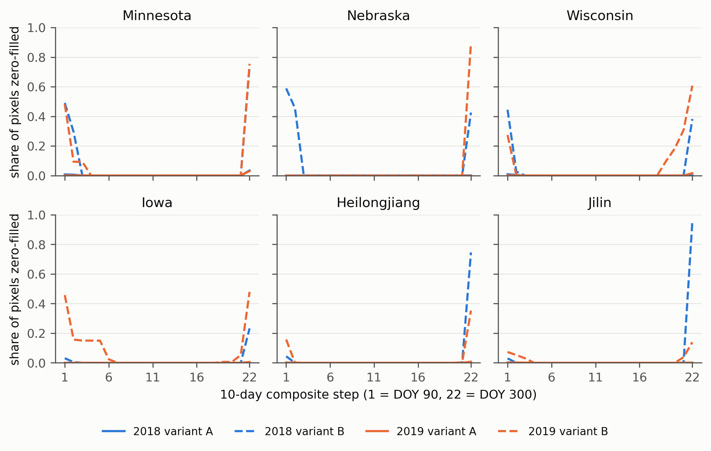
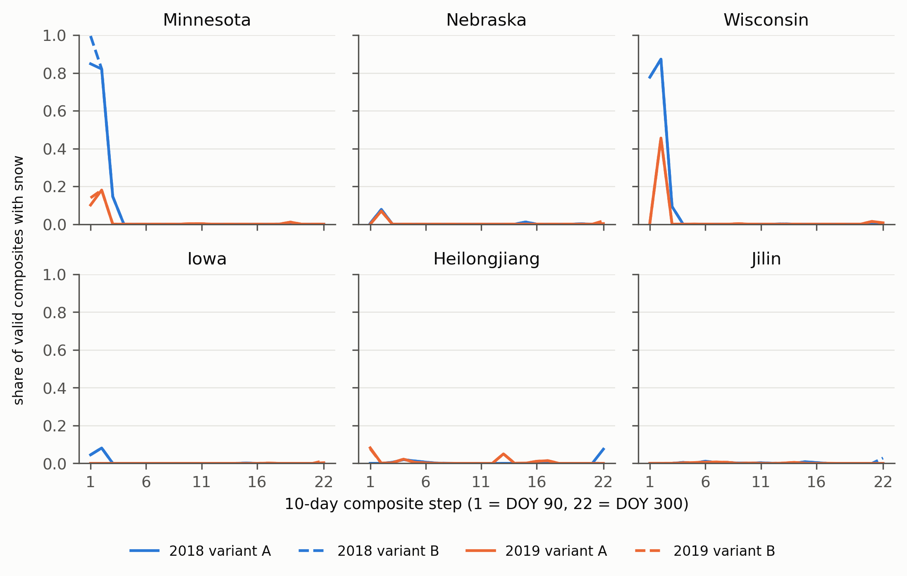

# DACCN audit: how often does the You et al. 2021 recipe zero-fill, and does it differ between DACCN's source and target domains?

Wang, Feng, Zhang and Tian 2023 (ISPRS JPRS 199, [10.1016/j.isprsjprs.2023.04.002](https://doi.org/10.1016/j.isprsjprs.2023.04.002)) transfer a crop classifier between Minnesota, Nebraska, Wisconsin, Iowa, Heilongjiang and Jilin and between 2018 and 2019, and attribute the unadapted losses to meteorology-driven phenological shift. They released no code but state that preprocessing followed You et al. 2021 (Scientific Data 8:41, [10.1038/s41597-021-00827-9](https://doi.org/10.1038/s41597-021-00827-9)), whose Earth Engine script is deposited on figshare ([13090442](https://figshare.com/articles/figure/The_10-m_crop_type_maps_in_Northeast_China_during_2017-2019/13090442), CC BY 4.0; copy in `you2021_GEE_code_for_crop_classification.js`). The script's "linear interpolation" of empty 10-day composites searches at most nine composites on each side and then calls `unmask(0)`, so any pixel without a valid composite on one side within 90 days is set to zero in every feature. Neither paper counts how often that happens. This audit re-runs the compositing and interpolation stage with two counters added.

## What was measured

`you2021_recipe.py` ports the script to the Earth Engine Python API: `COPERNICUS/S2_HARMONIZED` L1C scaled to reflectance, the Hancher, Hewig and Housman simple cloud score with threshold 0.2 and no shadow test, 37 ten-day median composites from DOY 0, interpolation of list indices 9 to 30 (22 steps, DOY 90 to 300) with the nine-composite search, and the `unmask(0)` semantics. For every sampled pixel it records `valid_k` (the step's own median was unmasked) and `zero_k` (the step ended as zero: invalid itself and no valid composite within nine steps before or after), plus `n_valid` and `n_zero`. `reference.py` is a numpy model of the same rule, unit-tested against hand-derived cases.

Two variants bracket what DACCN did. Variant A is the recipe as deposited: imagery for the whole calendar year, so the April and October edge steps can borrow from winter composites. Variant B feeds only April 1 to October 31 imagery, which is what DACCN says it used, so nothing outside the window exists to interpolate from. Variant B is a counterfactual, not a literal run of the deposited script: when a before or after window contains no composite with imagery, the script's `mosaic().select(bands)` is applied to an image with no bands and Earth Engine raises an error (verified: `Image.select: Band pattern 'red' was applied to an Image with no bands`), so the deposited script cannot run on April to October imagery alone. The port substitutes a fully masked image for an empty window, which lets the `unmask(0)` branch fire as it would for any masked neighbour. DACCN therefore either pulled imagery beyond its stated window (in which case Variant A describes its inputs and the zero-fill rate is small) or altered the edge handling (in which case Variant B describes the zeros its inputs carried, provided the `unmask(0)` fallback survived the alteration).

Sampling frame: in the four US states, CDL pixels of corn (1), soybeans (5) and a pooled "other" class (spring wheat, winter wheat, alfalfa, oats, dry beans, sugarbeets) with CDL confidence above 90, mirroring DACCN's own labelling; in the two Chinese provinces, ESA WorldCover 2020 cropland (class 40), because the You et al. maps are not in the Earth Engine catalogue. Design: 16 random 5 km cells per region (seed 42, the same cells for both years and both variants), 100 stratified points per class per cell at 10 m, computed interactively per cell. A whole-state request exceeds Earth Engine's memory limit and a batch export of 300 state-wide points ran for 40 minutes before it was cancelled.

## How to run

```bash
conda activate ee
python experiments/external_audits/daccn/01_regions.py       # GAUL lookups and frame labels (sanity check)
python experiments/external_audits/daccn/02_run_counters.py  # 24 region-year-variant jobs, ~25 min, resumable; results/daccn_counters.csv
python experiments/external_audits/daccn/03_summarise.py     # results/daccn_summary.csv, daccn_pairs.csv, figures/daccn_zero_by_step.png
```

Deviations from the deposited script, all deliberate: one carrier band (`red`) instead of the ten indices, since zero fill applies to every band identically; no Savitzky-Golay step (the module `users/nanshany1993/common:sentinel2` is private, and smoothing only spreads zeros across seven steps); the two counters; and a fully masked placeholder for an empty before or after window, where the deposited script would raise (see above). DACCN reports 21 steps and a quadratic smoother against the script's 22 and cubic, so the port measures the recipe as deposited and the edge behaviour is an inference about how closely DACCN reproduced it.

## Results

Share of sampled cropland pixels with at least one zero-filled step (`share_any_zero`), mean number of zero steps, and the share zero at the first and last step, generated from `results/daccn_summary.csv`. Cells is the number of the 16 cells that returned points (variant A jobs lost some cells to the Earth Engine memory limit; `results/run_log_02_run_counters.json` lists the 40 failed cells and every cell's coordinates).

| Region | Year | Variant A: any zero | A: mean zeros | A: cells | Variant B: any zero | B: mean zeros | B: zero at step 1 | B: zero at step 22 | B: cells | B: cell SD |
|---|---|---|---|---|---|---|---|---|---|---|
| Minnesota | 2018 | 0.041 | 0.05 | 9 | 0.906 | 1.52 | 0.49 | 0.74 | 11 | 0.23 |
| Minnesota | 2019 | 0.031 | 0.03 | 6 | 0.887 | 1.42 | 0.48 | 0.75 | 10 | 0.21 |
| Nebraska | 2018 | 0.000 | 0.00 | 9 | 0.592 | 1.47 | 0.59 | 0.43 | 12 | 0.46 |
| Nebraska | 2019 | 0.000 | 0.00 | 7 | 0.893 | 0.89 | 0.00 | 0.89 | 10 | 0.37 |
| Wisconsin | 2018 | 0.008 | 0.01 | 12 | 0.662 | 0.85 | 0.44 | 0.38 | 14 | 0.35 |
| Wisconsin | 2019 | 0.017 | 0.02 | 12 | 0.687 | 1.47 | 0.27 | 0.61 | 14 | 0.42 |
| Iowa | 2018 | 0.000 | 0.00 | 14 | 0.257 | 0.27 | 0.03 | 0.23 | 16 | 0.37 |
| Iowa | 2019 | 0.006 | 0.01 | 12 | 0.687 | 1.63 | 0.46 | 0.48 | 16 | 0.38 |
| Heilongjiang | 2018 | 0.005 | 0.00 | 10 | 0.746 | 0.79 | 0.04 | 0.75 | 13 | 0.43 |
| Heilongjiang | 2019 | 0.009 | 0.01 | 10 | 0.381 | 0.51 | 0.16 | 0.35 | 13 | 0.48 |
| Jilin | 2018 | 0.001 | 0.00 | 14 | 0.956 | 0.99 | 0.03 | 0.96 | 16 | 0.12 |
| Jilin | 2019 | 0.003 | 0.01 | 14 | 0.157 | 0.33 | 0.07 | 0.14 | 16 | 0.33 |

Mean valid composites out of 22 lie between 16.7 and 20.0 in every region-year under both variants; the recipe interpolates three to five steps per pixel in all domains.

DACCN's transfer pairs under Variant B (share of pixels with any zero, source then target):

| Pair | 2018 | 2019 |
|---|---|---|
| Minnesota to Wisconsin | 0.91 to 0.66 | 0.89 to 0.69 |
| Nebraska to Iowa | 0.59 to 0.26 | 0.89 to 0.69 |
| Minnesota to Heilongjiang | 0.91 to 0.75 | 0.89 to 0.38 |
| Nebraska to Jilin | 0.59 to 0.96 | 0.89 to 0.16 |
| Each region 2018 to 2019 | Minnesota 0.91 to 0.89, Nebraska 0.59 to 0.89, Wisconsin 0.66 to 0.69, Iowa 0.26 to 0.69, Heilongjiang 0.75 to 0.38, Jilin 0.96 to 0.16 | |

Under Variant A every pair differs by less than 0.04.



## Finding

The deposited recipe has two very different behaviours depending on what imagery it is given, and the paper's one-paragraph description does not say which it got. Fed the whole year (Variant A, the script as deposited), it almost never zero-fills: at most 4 percent of cropland pixels receive any zero and the mean is a few hundredths of a step, because the nine-composite search reaches into winter scenes on both sides of the April to October window. Restricted to April to October imagery, as DACCN states (Variant B, which requires an edge-handling change the deposited script lacks), the search has nothing to find beyond the window edges, and between 16 and 96 percent of pixels receive at least one zero-filled step, almost all at step 1 (first ten days of April) and step 22 (late October), with 0.3 to 1.6 zero steps per pixel on average. Those zeros are not random noise: they are a constant 0 in all twelve features at the start or end of the series, which the seven-step Savitzky-Golay smoother then spreads inward.

The rate differs sharply across exactly the pairs DACCN transfers. Nebraska to Jilin goes from 59 percent of source pixels zero-filled to 96 percent of target pixels in 2018 and from 89 to 16 percent in 2019; Minnesota to Heilongjiang from 91 to 38 percent in 2019; Nebraska to Iowa from 59 to 26 percent in 2018; and the temporal cases swing by up to 80 points (Jilin 96 to 16, Iowa 26 to 69, Heilongjiang 75 to 38). A classifier that learned, say, Jilin 2018 with a zero in nearly every pixel's final step and is then applied to Jilin 2019 where only one pixel in six has it, meets a feature distribution shift that has nothing to do with crop calendars, and the maximum mean discrepancy that DACCN minimises will absorb it just as readily as a real phenological shift. The audit cannot apportion DACCN's losses between the two, and it cannot tell which variant DACCN ran. What it shows is conditional: if DACCN used only the April to October imagery it describes, it must have changed the script's edge handling, and the zero-fill rate then differs between source and target by tens of percentage points in most pairs, in no consistent direction, uncounted by the recipe and unmentioned by the paper; if DACCN pulled year-round imagery, the deposited script applies and the zero-fill confound is small (under 4 percent of pixels). Either way the paper does not report which, and the difference between the two readings is the difference between a negligible confound and a large one. A separate check found snow in April composites that the recipe counts as valid, mainly Minnesota and Wisconsin 2018 (see Snow check below).

## Limitations of this audit

The ranks of the six regions are clustered estimates from 16 random 5 km cells (fewer where cells exceeded the Earth Engine memory limit in Variant A, listed in the run log), so the per-region shares carry between-cell spread of 0.1 to 0.5; the pair differences reported above are far larger than that spread for the extreme pairs and of the same order for the mild ones. The Chinese frame is WorldCover cropland rather than DACCN's crop-map labels. The port stops before smoothing and uses one carrier band; the counters would be identical for any band. The 22-step window and the edge behaviour follow the deposited script, which DACCN describes as 21 steps. Nothing here re-runs DACCN.

## Snow check

The recipe's cloud mask has no snow test, and its simple cloud score contains an NDSI term that lowers the score for bright snow (`rescale(NDSI, 0.8, 0.6)`, so pixels with green/SWIR1 NDSI above about 0.76 are scored as not cloud). Snow can therefore enter a composite the recipe counts as valid. April 2018 had a major Upper Midwest blizzard, so Minnesota and Wisconsin 2018 are the cases of interest. This section measures how often it happens, by region, year and step, on the same sample as the zero-fill counters.

### What was measured

`you2021_snow.py` rebuilds, for the 22 interpolated steps (DOY 90 to 300), the recipe's 10-day median composites of green (B3), SWIR1 (B11) and NIR (B8) from the same masked `COPERNICUS/S2_HARMONIZED` collection (same scaling, same cloud mask, same day-of-year windows, variants A and B as above) and flags snow on the composite with a rule independent of the recipe: NDSI = (B3 - B11)/(B3 + B11) > 0.42, B8 > 0.11 and B3 > 0.10 (`snowrule.py`). The NDSI and NIR conditions are the MODIS MOD10 snow-mapping rule (NDSI of 0.4 or more and NIR above 0.11; Hall et al. 2002, IEEE TGRS 40:1002; Riggs, Hall and Salomonson 2006, MOD10 ATBD), which the Sentinel-2 snow tests of Sen2Cor and MAJA (Hagolle et al. 2010, RSE 114:1747) adapt; the green floor is the MOD10 band-4 dark-target guard. 0.42 and the other cut-offs were fixed before the run; no sensitivity run was made. A step counts as snow-contaminated only if it is valid (the recipe left it unmasked). `04_snow_counters.py` samples exactly the cells and points of `02_run_counters.py` (it calls the same cell generator, seed 42, 100 stratified points per class per cell, per-cell seed offsets). For every job the valid-composite flags were compared row by row with `daccn_counters.csv`: every cell present in both is identical (all 24 jobs; `run_log_04_snow_counters.json`). The snow job is lighter than the counter job, so Variant A returned 2 to 4 more cells per region-year than the counters did; those extra cells are included here and are absent from the zero-fill tables.

Two cross-checks use the same 10-day window: `COPERNICUS/S2_SR_HARMONIZED` SCL class 11 (snow or ice) in any L2A scene in the window, and `MODIS/061/MOD10A1` NDSI_Snow_Cover of 40 or more on any day in the window (500 m, so a coarse and lenient test). Sentinel-2 L2A coverage in Earth Engine is complete for the four US states in 2018 and 2019 and for both Chinese provinces in 2019, but not for Heilongjiang and Jilin in 2018: over the sampled cells there are only 168 L2A against 1378 L1C scenes in Heilongjiang and 127 against 934 in Jilin between April 1 and October 31 (`results/daccn_snow_l2a_coverage.csv`), so SCL covers 38 and 40 percent of valid composites there and MODIS is the only independent check.

### How to run

```bash
python experiments/external_audits/daccn/04_snow_counters.py     # 24 jobs, ~1 h, resumable; results/daccn_snow_counters.csv, daccn_snow_l2a_coverage.csv
python experiments/external_audits/daccn/05_snow_summarise.py    # daccn_snow_summary.csv, _crosscheck.csv, _pairs.csv, figures/daccn_snow_by_step.png
```

### Results

Share of sampled cropland pixels with at least one snow-flagged valid step (`any snow`), mean number of such steps, share of all valid steps flagged, and the share of pixels with a flagged step in April (steps 1 to 3), October (steps 20 to 22) and between (steps 4 to 19), from `results/daccn_snow_summary.csv`. Cells is the number of the 16 cells that returned points.

| Region | Year | A: any snow | A: mean snow steps | A: cells | B: any snow | B: mean snow steps | B: share of valid steps | B: April (steps 1-3) | B: October (steps 20-22) | B: steps 4-19 | B: cell SD |
|---|---|---|---|---|---|---|---|---|---|---|---|
| Minnesota | 2018 | 0.783 | 1.35 | 11 | 0.632 | 1.19 | 0.064 | 0.632 | 0.000 | 0.001 | 0.41 |
| Minnesota | 2019 | 0.236 | 0.25 | 10 | 0.236 | 0.25 | 0.013 | 0.232 | 0.000 | 0.013 | 0.45 |
| Nebraska | 2018 | 0.052 | 0.05 | 12 | 0.052 | 0.05 | 0.003 | 0.039 | 0.002 | 0.011 | 0.16 |
| Nebraska | 2019 | 0.067 | 0.07 | 10 | 0.067 | 0.07 | 0.004 | 0.066 | 0.002 | 0.000 | 0.18 |
| Wisconsin | 2018 | 0.853 | 1.37 | 14 | 0.853 | 1.37 | 0.070 | 0.853 | 0.000 | 0.001 | 0.30 |
| Wisconsin | 2019 | 0.469 | 0.48 | 14 | 0.463 | 0.47 | 0.026 | 0.456 | 0.008 | 0.002 | 0.47 |
| Iowa | 2018 | 0.071 | 0.12 | 16 | 0.071 | 0.12 | 0.006 | 0.070 | 0.000 | 0.001 | 0.25 |
| Iowa | 2019 | 0.003 | 0.00 | 16 | 0.008 | 0.01 | 0.000 | 0.000 | 0.007 | 0.001 | 0.02 |
| Heilongjiang | 2018 | 0.103 | 0.12 | 13 | 0.029 | 0.05 | 0.002 | 0.005 | 0.000 | 0.027 | 0.10 |
| Heilongjiang | 2019 | 0.155 | 0.16 | 13 | 0.151 | 0.16 | 0.008 | 0.068 | 0.000 | 0.085 | 0.26 |
| Jilin | 2018 | 0.026 | 0.03 | 16 | 0.027 | 0.03 | 0.002 | 0.000 | 0.001 | 0.026 | 0.06 |
| Jilin | 2019 | 0.019 | 0.03 | 16 | 0.019 | 0.03 | 0.002 | 0.000 | 0.000 | 0.019 | 0.05 |

Agreement with the two independent checks, Variant B, over valid composites that have data in the check (`results/daccn_snow_crosscheck.csv`; flag = composite NDSI rule):

| Region | Year | L2A scenes / L1C scenes (Apr-Oct, sampled cells) | Flagged composites with SCL data | SCL snow given flag | SCL snow given no flag | Flagged with MODIS data | MODIS snow given flag | MODIS snow given no flag |
|---|---|---|---|---|---|---|---|---|
| Minnesota | 2018 | 879 / 890 | 3231 of 3231 | 0.72 | 0.02 | 3217 | 0.95 | 0.03 |
| Minnesota | 2019 | 893 / 901 | 665 of 665 | 0.87 | 0.01 | 665 | 0.97 | 0.02 |
| Nebraska | 2018 | 932 / 932 | 145 of 145 | 0.76 | 0.01 | 145 | 0.72 | 0.01 |
| Nebraska | 2019 | 934 / 934 | 177 of 177 | 0.99 | 0.02 | 177 | 0.96 | 0.01 |
| Wisconsin | 2018 | 806 / 807 | 5262 of 5262 | 0.66 | 0.03 | 5262 | 0.99 | 0.04 |
| Wisconsin | 2019 | 822 / 822 | 1685 of 1685 | 0.87 | 0.01 | 1685 | 0.95 | 0.01 |
| Iowa | 2018 | 836 / 844 | 498 of 498 | 0.71 | 0.00 | 498 | 0.89 | 0.01 |
| Iowa | 2019 | 861 / 861 | 35 of 35 | 0.74 | 0.00 | 35 | 0.60 | 0.00 |
| Heilongjiang | 2018 | 168 / 1378 | 168 of 180 | 0.00 | 0.00 | 179 | 0.12 | 0.01 |
| Heilongjiang | 2019 | 1412 / 1412 | 617 of 617 | 0.42 | 0.03 | 616 | 0.43 | 0.02 |
| Jilin | 2018 | 127 / 934 | 93 of 163 | 0.00 | 0.00 | 163 | 0.00 | 0.01 |
| Jilin | 2019 | 942 / 943 | 142 of 142 | 0.04 | 0.02 | 129 | 0.00 | 0.00 |

Share of pixels with any snow-flagged valid step, DACCN's transfer pairs under Variant B (source then target; `results/daccn_snow_pairs.csv`, which also holds Variant A):

| Pair | 2018 | 2019 |
|---|---|---|
| Minnesota to Wisconsin | 0.63 to 0.85 | 0.24 to 0.46 |
| Nebraska to Iowa | 0.05 to 0.07 | 0.07 to 0.01 |
| Minnesota to Heilongjiang | 0.63 to 0.03 | 0.24 to 0.15 |
| Nebraska to Jilin | 0.05 to 0.03 | 0.07 to 0.02 |
| Each region 2018 to 2019 | Heilongjiang 0.03 to 0.15, Iowa 0.07 to 0.01, Jilin 0.03 to 0.02, Minnesota 0.63 to 0.24, Nebraska 0.05 to 0.07, Wisconsin 0.85 to 0.46 | |



### Finding

Snow does pass the recipe's cloud mask, but only in early April and only in the northern US states in cold springs. In Minnesota 2018 every valid step 1 composite and 82 percent of step 2 composites are snow-flagged, which puts 63 percent of pixels (78 percent under Variant A) in at least one flagged step, 1.2 steps on average; Wisconsin 2018 reaches 85 percent of pixels and 1.4 steps. The flags are confirmed by the independent checks where they exist: of flagged Minnesota and Wisconsin composites 66 to 87 percent contain an SCL snow pixel (against 1 to 3 percent of unflagged composites) and 95 to 99 percent have MODIS snow in the window (against 1 to 4 percent). Contamination is absent from October and near zero in the growing season in every domain, so it affects one to three of the 22 steps and under 3 percent of all valid steps outside 2018 Minnesota and Wisconsin (about 7 percent there). Elsewhere it is rare: 0.3 to 7 percent of pixels in Nebraska and Iowa, 3 to 15 percent in Heilongjiang and 2 to 3 percent in Jilin, and in Jilin neither check confirms any flagged composite (MODIS 0 of 129 to 163, SCL 0 of 93 in 2018 and 5 of 142 in 2019), so those few flags are probably bright bare soil or residual cloud rather than snow.

It differs across DACCN's transfer pairs mainly through the 2018 Upper Midwest spring. Minnesota to Wisconsin moves from 63 to 85 percent of pixels in 2018 and from 24 to 46 percent in 2019, so source and target both carry snow-affected April features and the target more so; Minnesota to Heilongjiang goes from 63 to 3 percent in 2018 and 24 to 15 percent in 2019, and the Minnesota and Wisconsin temporal pairs swing by about 0.4 (Minnesota 63 to 24, Wisconsin 85 to 46 percent). Nebraska to Iowa and Nebraska to Jilin differ by under 0.07. The recipe's interpolation does not remove these steps because they count as valid. Whether a spring snow signature in one or two April composites is large enough to matter beside the zero-fill rates above is not something this audit can answer: the affected steps are the same steps (1 and 2) where Variant B zero-fills, and snow is a smaller and more regional effect than the zero-fill confound, concentrated in the one source domain (Minnesota 2018) and one target (Wisconsin).

### Limitations of the snow check

The snow rule is applied to the 10-day median composite, which can blend snow-covered and snow-free dates in the window and is evaluated at 20 m SWIR resampled to 10 m; a snow-free pixel can be flagged where one date is bright and another is not, and the fixed 0.42 cut-off was not tuned. MODIS at 500 m with any-day-in-window is lenient and SCL class 11 has its own confusion with cloud and bright soil, so the agreement figures bound rather than validate the flag; the unflagged-composite rates (1 to 4 percent) show the same checks also fire without the NDSI rule. The flag is not validated against labelled snow, and in Heilongjiang and Jilin the 2018 cross-check rests on MODIS alone. Samples are the same 16 random 5 km cells per region as the zero-fill audit, so per-region shares carry between-cell spread of 0.1 to 0.5 (the cell SD column), and Variant A has more cells than the zero-fill tables. Snow cover in April is real surface condition, not a cloud-mask failure in the sense of a missing pixel; the check shows only that the recipe has no step that excludes it. Nothing here re-runs DACCN or estimates the effect of snow on its accuracy.
