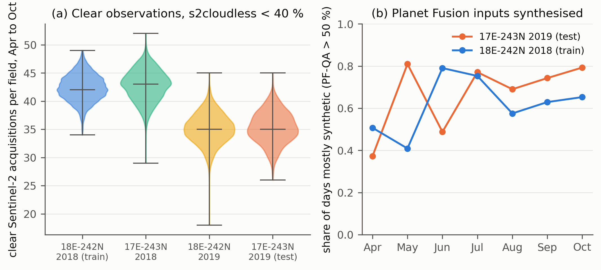

# DENETHOR audit: was the 2019 test year cloudier than the 2018 training year?

Kondmann et al. 2021 (NeurIPS Datasets and Benchmarks, [proceedings](https://datasets-benchmarks-proceedings.neurips.cc/paper/2021/hash/a8f15eda80c50adb0e71943adc8015cf-Abstract-round2.html); data [Source Cooperative esa/fusion-competition](https://source.coop/esa/fusion-competition); code [lukaskondmann/DENETHOR](https://github.com/lukaskondmann/DENETHOR)) train on Brandenburg tile 18E-242N in 2018 and test on tile 17E-243N in 2019, report about a 12 point drop out of year, and attribute it to "weather and growing cycles". The data ship daily Planet Fusion surface reflectance (gap-filled by the vendor), Sentinel-2 with a cloud-probability layer (CLP) and scene classification (SCL), and Sentinel-1. The training code never reads CLP or SCL (the concatenation is commented out in `s2dataset.py`), never reads the Planet Fusion QA rasters that say which days are synthesised, and the paper gives no per-year cloud statistic beyond "around 55 percent of S2 observations" being discarded overall. This audit measures the per-year difference from the shipped layers.

## What was measured

1. Clear Sentinel-2 acquisitions per field, for all four tile-years in the bucket (both tiles in both years, 144 acquisitions each, identical monthly counts), from `CLP.npy`, `SCL.npy` and `IS_DATA.npy` zonally averaged over the shipped label polygons (labels of a tile are reused for its other year). Three rules: the authors' literal `cld < 40` on the stored 0 to 255 scale (a 15.7 percent cut); s2cloudless probability below 40 percent (CLP below 102, the shared cross-paper rule, primary); and field-majority SCL in {4, 5, 6, 7} with IS_DATA true. The two-by-two separates the tile change from the year change.
2. Planet Fusion synthetic fraction for the two benchmark tile-years, April 1 to October 31, from PF-QA layer 1 (percent synthetic, 1 = observed, 100 = fully gap-filled) and layer 2 (days to nearest real observation, 900 = unknown), zonally averaged per field per day at 3 m.

## How to run

```bash
conda activate ee
python experiments/external_audits/denethor/01_fetch_masks.py        # ~10 GB of CLP/SCL/IS_DATA + labels, SHA-256 manifest
python experiments/external_audits/denethor/02_s2_clear_counts.py    # results/s2_field_summary.csv, s2_field_dates.csv.gz
python experiments/external_audits/denethor/03_pf_qa_synthetic.py    # results/pfqa_field_month.csv, pfqa_field_day.csv.gz (streams ~12 GB of PF-QA COGs, deleted day by day)
python experiments/external_audits/denethor/04_summarise.py          # results/denethor_summary.csv, denethor_2x2.csv, figures/denethor_clear_and_synthetic.png
```

`03_pf_qa_synthetic.py --cache-only 17E-243N:2019` runs one tile-year in a second process to halve the wall time.

## Results

Clear Sentinel-2 acquisitions per field (medians; 144 acquisitions per tile-year):

| Tile-year | Fields | Clear, s2cloudless < 40 % | Clear, authors' literal rule | Clear, SCL rule | Clear Apr to Oct (84 acquisitions), s2cloudless | Longest clear-free gap Apr to Oct, days |
|---|---|---|---|---|---|---|
| 18E-242N 2018 (train) | 2530 | 54 | 40 | 48 | 42 (IQR 41 to 44) | 20 |
| 17E-243N 2018 | 2062 | 55 | 40 | 49 | 43 (41 to 45) | 20 |
| 18E-242N 2019 | 2530 | 48 | 31 | 43 | 35 (33 to 37) | 18 |
| 17E-243N 2019 (test) | 2062 | 48 | 31 | 43 | 35 (33 to 37) | 19 |

Two-by-two margins on the median clear count: year effect −6 (18E-242N) and −7 (17E-243N) under the s2cloudless rule, −9 and −9 under the authors' literal rule; tile effect +1 and 0. The benchmark pair (train 2018, test 2019) therefore differs by the year, not by the tile.

Mean clear acquisitions per field by month, s2cloudless rule:

| Tile-year | Apr | May | Jun | Jul | Aug | Sep | Oct |
|---|---|---|---|---|---|---|---|
| 18E-242N 2018 (train) | 8.4 | 6.5 | 3.5 | 6.7 | 6.1 | 6.2 | 6.1 |
| 17E-243N 2018 | 7.7 | 7.3 | 3.4 | 7.4 | 4.8 | 6.2 | 7.0 |
| 18E-242N 2019 | 7.7 | 4.1 | 5.2 | 4.7 | 3.8 | 7.3 | 2.5 |
| 17E-243N 2019 (test) | 7.5 | 3.2 | 6.1 | 5.7 | 3.6 | 7.0 | 2.2 |

Planet Fusion daily inputs, April to October, benchmark tile-years:

| Tile-year | Share of days mostly synthetic (PF-QA > 50 %) | Mean percent synthetic | Mean days to nearest real observation | By month (Apr to Oct), share mostly synthetic |
|---|---|---|---|---|
| 18E-242N 2018 (train) | 0.617 | 61.9 | 1.44 | 0.51, 0.41, 0.79, 0.75, 0.58, 0.63, 0.65 |
| 17E-243N 2019 (test) | 0.667 | 66.9 | 1.57 | 0.37, 0.81, 0.49, 0.77, 0.69, 0.74, 0.79 |



## Finding

The test year was cloudier than the training year, and the two tiles were not different from each other. A field in the 2019 test tile had a median of 35 clear Sentinel-2 acquisitions between April and October against 42 in the 2018 training tile, a loss of one sixth; under the authors' own stricter cloud rule the full-year count falls from 40 to 31, a loss of more than a fifth. The 2018 tile that was not used, and the 2019 tile that was not used, show the same numbers as their year-mates, so the tile change contributes nothing and the year change contributes all of it. The loss is concentrated in May (6.5 clear acquisitions in 2018 against 3.2 to 4.1 in 2019), August and October (6.1 against 2.2 to 2.5), the months that separate winter cereals, maize and the autumn-sown crops in Brandenburg. Pham et al. 2024 report 2018 as the clearest year in Brandenburg's 2010 to 2021 record; these counts put 2019 well below it.

The Planet Fusion cubes the models actually consumed hide this difference rather than remove it. In both years roughly two thirds of the daily inputs over fields were synthesised rather than observed (62 percent of days mostly synthetic in 2018, 67 percent in 2019), and the months in which 2019 was most synthetic (May 81 percent, October 79 percent) are the months in which 2018 was least (41 and 65 percent). A model trained on the 2018 cube learned a May and an October that were mostly observed, and was tested on a May and an October that were mostly interpolated. The paper's "around 55 percent of S2 observations" discarded is a single pooled figure that cannot show this. The DENETHOR out-of-year loss is therefore measured across a change in missingness that the paper did not report and the code did not model; this audit does not say how much of the 12 point drop it explains, only that the year change in cloud structure is real, of the order of one fifth of the clear observations, and was never separated from "weather and growing cycles".

## Limitations of this audit

Labels for a tile were drawn in one year and reused for the other, so the field set is fixed per tile and crops may differ across years; the clear counts depend only on geometry. The CLP scale was inferred from the array (maximum 255) and the authors' intent for `cld < 40` is undocumented, so both readings are reported. The PF-QA "percent synthetic" layer is the vendor's own flag and its definition of a synthetic day is the vendor's; 24 PF-QA rasters for August to October 2019 are absent from the bucket and are excluded from denominators. Field means of CLP smooth sub-field cloud; the SCL rule is reported as a check. Nothing here re-runs the DENETHOR models.
