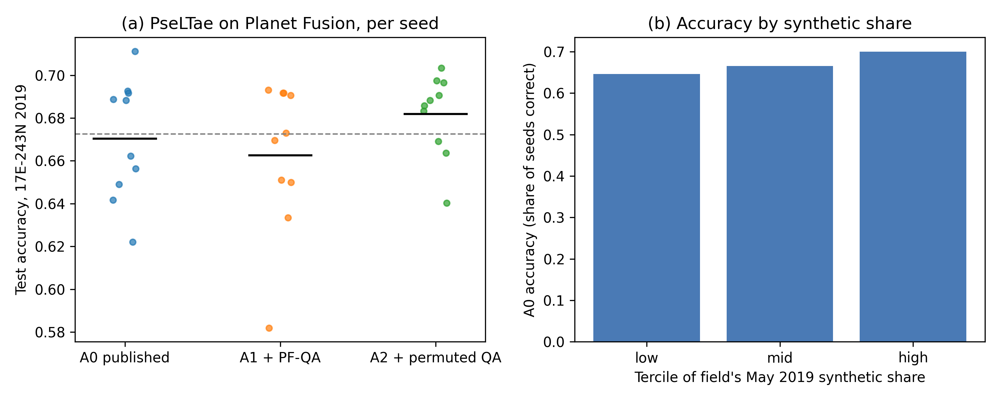

# DENETHOR re-run: does the 2019 test year's missingness explain the transfer drop?

The descriptive audit in `../denethor/` showed that DENETHOR's 2019 test tile has fewer clear Sentinel-2 acquisitions per field than the 2018 training tile (35 against 42, April to October) and that the Planet Fusion cubes the deep models consume were synthesised on 81 percent of May days in 2019 against 41 percent in 2018, a difference the loader cannot see because it never reads the PF-QA layer. It left open whether that difference costs accuracy. This folder tests it with the authors' own recipes (Kondmann et al. 2021, [NeurIPS Datasets and Benchmarks](https://datasets-benchmarks-proceedings.neurips.cc/paper/2021/file/5b8add2a5d98b1a652ea7fd72d942dac-Paper-round2.pdf); code [lukaskondmann/DENETHOR](https://github.com/lukaskondmann/DENETHOR) at commit 55573a8; data from the [Source Cooperative mirror](https://source.coop/esa/fusion-competition)). No trained models were released, so both arms retrain.

## What was done

**Planet Fusion arm (PseLTae).** The authors' PseLTae configuration is retrained on 18E-242N 2018 and tested on 17E-243N 2019 with the recipe of `train_psetae.py` and the paper: Adam at 1e-3, weight decay 1e-6, batch 64, 100 epochs, a 25 percent validation split with `RandomState(0)`, the checkpoint with the lowest validation loss from epoch 3 on, 20 random pixels per field per sample with the authors' normalisation jitter, and a single stochastic test pass (a ten-pass mean is also kept). To make the run fit on disk, 128 pixel positions per field are fixed once and only those are extracted from the 730 daily GeoTIFFs (`01_extract_pf.py`); training still draws 20 of them per sample. Three conditions, ten seeds each: A0 as published; A1 with the PF-QA synthetic percentage (divided by 100) added as a fifth input channel, so the model knows which pixel-days were reconstructed; A2 with the same QA values permuted across days within each field, which keeps the channel's distribution and the extra parameter count but breaks its alignment with the data. If the synthetic share drives the drop, A1 should beat A2. Separately, A0 test accuracy (share of seeds correct per field) is stratified by each field's 2019 synthetic share.

**Sentinel-2 arm (random forest).** The authors' `random_forest.py` is rebuilt from field-mean series built as `s2dataset.setup()` builds them: 12 bands plus NDVI, an acquisition counted when its field-mean CLP is below 40 (the literal `cld < 40`, on CLP's 0 to 255 scale), max, min, median, mean and standard deviation over the counted acquisitions plus the positions of the max and min, 91 features, `RandomForestClassifier(random_state=0)`. Conditions: B0 as published, and B0seeds with forest seeds 0 to 9; B1train, each training field thinned month by month to its own clear count in 2019 (from the CLP of 18E-242N 2019) and the forest retrained, 10 draws; B1trainctrl, the same number of clear training acquisitions dropped per field at random across months; B1 and B1ctrl, the same pair applied at test time to the test tile's 2018 imagery. The month-matched minus random contrast isolates the 2019 gap pattern from the plain loss of observations.

## How to run

```bash
bash experiments/external_audits/denethor_rerun/run.sh   # env deep_field (GPU)
```

Data live under `/mnt/bigdrive/external_audits/denethor_rerun/` (Planet Fusion pixel extracts about 2.1 GB, Sentinel-2 field series about 50 MB; the raw cubes are deleted after reduction). The 30 PseLTae runs take about 70 minutes on an RTX 3080 Ti; the forest conditions take under a minute. Not part of `../run_all.sh`.

## Results

Reproduction. Retrained PseLTae (A0) reaches 67.0 ± 2.8 percent test accuracy over ten seeds against the paper's 67.25, and 85.5 ± 1.3 percent validation accuracy against 88.02, 2.5 points low (`results/pf_condition_summary.csv`). The forest reproduces Table 3 exactly: 59.1 percent accuracy and 0.418 macro F1 against 0.59 and 0.42 (`results/rf_summary.csv`).

PseLTae on Planet Fusion, 17E-243N 2019 test tile, mean ± SD over ten seeds:

| Condition | Validation accuracy | Test accuracy | Test macro F1 |
|---|---|---|---|
| A0 as published | 85.5 ± 1.3 | 67.0 ± 2.8 | 56.2 ± 5.0 |
| A1 + PF-QA channel | 85.4 ± 1.1 | 66.3 ± 3.5 | 53.0 ± 5.0 |
| A2 + permuted QA | 84.3 ± 0.7 | 68.2 ± 1.9 | 54.9 ± 3.6 |

Paired over seeds (`results/pf_contrasts.csv`), A1 minus A2 is -1.9 accuracy points (95 percent t interval -4.9 to +1.1, Wilcoxon p = 0.32) and -1.9 macro-F1 points (-5.6 to +1.9). A1 minus A0 is -0.8 accuracy points (-3.8 to +2.2) and -3.2 macro-F1 points (-6.2 to -0.2, p = 0.04). Stratified by the field's share of mostly synthetic pixel-days (`results/pf_synthetic_strata.csv`), A0 accuracy rises rather than falls with the synthetic share: 64.6, 66.5 and 70.0 percent across May terciles (Spearman rho +0.05, p = 0.01), 63.0, 68.4 and 69.7 percent across whole-year terciles (rho +0.10).

Random forest, 2019 test tile, literal rule (`results/rf_contrasts.csv`, Welch t over 10 draws):

| Condition | Accuracy | Macro F1 |
|---|---|---|
| B0seeds (published, 10 forest seeds) | 59.2 ± 0.3 | 0.429 |
| B1train (training thinned to 2019 month counts) | 60.5 ± 0.6 | 0.424 |
| B1trainctrl (same number thinned at random) | 60.3 ± 0.4 | 0.429 |

The 2019 month pattern adds +0.15 accuracy points over random thinning (p = 0.51) and -0.5 macro-F1 points (p = 0.22). Thinning of either kind adds about 1.2 accuracy points over the seed spread (p < 0.001) and nothing in macro F1. At test time, B1 minus B1ctrl is +0.3 accuracy points (p = 0.21). Under the s2cloudless 40 percent rule B0 gives 58.3 percent.



## Finding

The missingness difference between DENETHOR's training and test years is real but does not explain its transfer drop, so DENETHOR moves to rank 2. Telling PseLTae which Planet Fusion pixel-days were synthesised does not help: the aligned QA channel scores 1.9 points below the same values scrambled across days, and A1 is no better than the published model. Fields whose 2019 series are most synthesised are classified slightly better, not worse, the opposite of what the missingness reading predicts, which suggests the vendor's reconstruction is benign for this classifier, or that synthetic share correlates with crop type or field size in a way that favours easy fields. For the Sentinel-2 forest, imposing the test year's month-by-month clear-acquisition pattern on the training data is indistinguishable from dropping the same number of acquisitions at random. Thinning helps the forest's accuracy slightly in either form, probably because the max, min and position features become less dominated by extremes, but macro F1 does not move. Neither arm leaves room for missingness to account for a material share of the 12-point temporal component the paper attributes to weather and growing cycles. The paper's omission stands as a reporting gap, since it never states the synthetic share or clear counts per year, but its attribution survives the test.

## Limitations of this audit

No Planet Fusion data exist publicly for the test tile in 2018, and only 2019 labels exist for that tile, so neither arm can reproduce the paper's split of the drop into spatial and temporal parts. The forest's 2018-imagery rows reuse 2019 labels that crop rotation makes wrong for an unknown share of fields (hence their 46 percent accuracy) and serve only for the within-2018 B1 against B1ctrl contrast. PseLTae validation accuracy is 2.5 points below the paper's, which may reflect the fixed 128-pixel pool, the different GPU and library versions, or a seed the paper does not report; test accuracy matches. The QA intervention is training-time feature augmentation, one of several ways to make a model missingness-aware; masking or dropout of synthesised days could behave differently. The ten seeds give a t interval of about ±3 points on the A1 minus A2 contrast, so effects below that cannot be excluded. Only the PseLTae model and the random forest are re-run, not the paper's other deep baselines or its Sentinel-1 arm.
