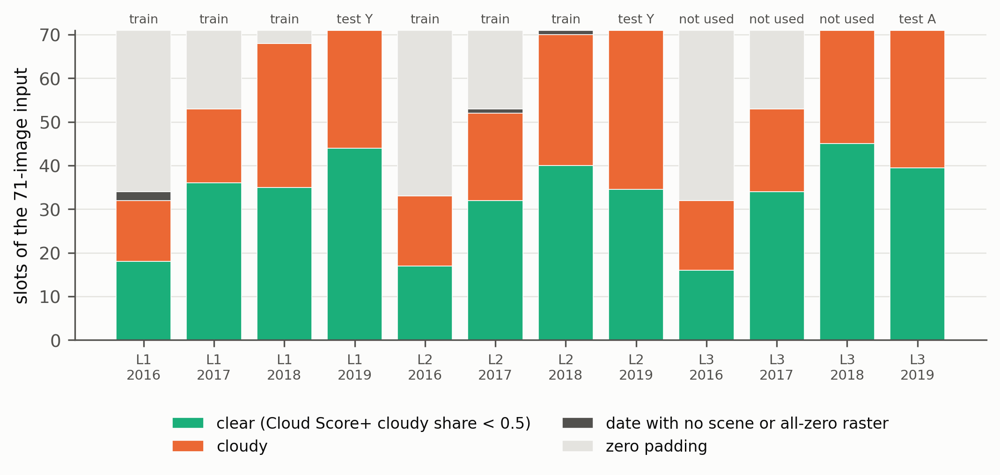

# Gallo et al. 2023 audit: do zero padding and cloud contamination differ between training and test series?

Gallo et al. 2023 ([ISPRS JPRS 195:335-352](https://doi.org/10.1016/j.isprsjprs.2022.12.005); code [GitLab](https://gitlab.com/artelabsuper/in-season-and-dynamic-crop-mapping); data [Kaggle ignazio/sentinel2-crop-mapping](https://www.kaggle.com/datasets/ignazio/sentinel2-crop-mapping)) train a 3D CNN on Lombardy areas L1 and L2 for 2016 to 2018 and test on L1+L2 in 2019 (test Y) and on a new area L3 in 2019 (test A). Per the audit report, no cloud mask is applied and each annual series is harmonised to 71 images (zero images appended if shorter, random subsample if longer). Overall accuracy falls 77.2, 72.8, 70.5, which the paper attributes to the "Unknown cropland" label. This audit measures, per area and year, how many images the series holds (hence the zero-padded share of the 71 slots) and how many of them are cloudy over cropland. Nothing is re-run.

## Step 0: what could be pinned down

The paper PDF could not be read. The CNR IRIS copy, the ScienceDirect page and the Insubria repository all answer 403 (Cloudflare challenge) to scripted requests, and the earlier saved `paper/gallo.pdf` is such a challenge page. Study-area footprints, tile ids, product level and date window therefore do not come from the paper text. What does exist is the authors' own deposit on Kaggle, whose anonymous file listing gives every image date of every 48 x 48 patch (4,586,027 file names), and whose rasters carry coordinates and 9 bands of unmasked reflectance. The deposit is what the loader reads, so the series length per area-year and the pixel content are measured on it directly. The product level and the exact scene filter used to build the deposit are not known. Their effect is visible in the rasters: scenes are unmasked (cloud and snow present), and a few dates are all-zero.

The release repository has no padding step. `utils/sentinel_daily_annual_dataset.py` returns as many dates as the patch folder holds, with `random.sample` down to the maximum length (or a consecutive window when exporting), and `predict_daily_annual.py` allocates `torch.zeros(71,9,5,48,48)`. The padding rule is taken from the task description of the paper and is applied here arithmetically, not observed.

## What was measured

1. `01_list_kaggle.py` crawls the anonymous Kaggle listing (200 names per page, resumable, throttled). `02_date_counts.py` turns it into images per patch folder and area-year. All 3,328 patch folders of an area-year hold the same dates (`dates_in_all_patches` equals `dates_union` in `results/date_counts_by_area_year.csv`), so each area-year is one series. Pad slots are 71 minus the number of dates, or the subsampling keep rate 71/n when there are more than 71 dates.
2. `03_footprints.py` reads the coordinates of 30 seeded random patches per area (EPSG:32632 UTM; L1 about 10.3 to 10.7 E, 45.1 to 45.3 N, east Lombardy; L2 8.7 to 9.0 E, 45.1 to 45.3 N, Lomellina; L3 9.4 to 9.8 E, 45.3 to 45.55 N, around Lodi and Milan). The same patch ids are used in every year; one other-year raster per area was not cross-checked.
3. `04_ee_cloud_by_date.py`, per deposit date and area-year: Earth Engine `COPERNICUS/S2_HARMONIZED` granules touching the 30 patches on that UTC date (nearest sensing date within one day), Cloud Score+ (`GOOGLE/CLOUD_SCORE_PLUS/V1/S2_HARMONIZED`, cs_cdf below 0.6 is cloudy) mosaic, and the cloudy and no-data share over ESA WorldCover 2020 cropland and over all pixels at 10 m. A date is cloudy when at least half of its cropland pixels are cloudy; it is a no-data date when no granule exists or its raster is all zero. 683 dates in all, none unmatched to a granule except 2016-02-09 in L1.
4. `05_pixel_check.py` reads 3 patches per area-year straight from the deposit (2,049 images): share of all-zero pixels and share with blue reflectance above 2000 (x10000). Date-level correlation with the Cloud Score+ cloudy share is 0.88 to 0.96 per area-year (`results/gallo_ee_vs_raster.csv`). Two L1 2016 dates (2016-02-09 and 2016-04-29) are all-zero in the deposit; the second has Sentinel-2 granules in Earth Engine, so it is a missing deposit image rather than a missing acquisition.
5. `06_summarise.py` fills the 71 slots per area-year, pools them (training L1+L2 2016 to 2018, test Y, test A), computes the same-slot calendar shift between series, and draws the figure.

Run: `bash experiments/external_audits/gallo/run.sh` (about 4 hours, almost all of it step 01), or the numbered scripts from the repo root in the `ee` env. Each step skips work whose output exists and takes `--force`; the Earth Engine step can also be run per `--areas`. Seed 42. Tests: `python -m pytest experiments/external_audits/tests -q -k gallo`. `99_cleanup.py` deletes the downloads and keeps `manifest.json`. Step 04 was run as three parallel per-area processes, so `run_log_04_ee_cloud_by_date.json` describes the last one to finish; a final no-op pass confirmed all 683 rows are present.

## Results

Per area-year (slots out of 71; clear and cloudy are dates with cropland cloudy share below or at least 0.5; `results/gallo_area_year.csv`):

| Area, year | Dates | Pad slots | Clear dates | Cloudy dates | No-data dates | Zero slots (pad + no-data) | Clear slots | Cloudy slots |
|---|---|---|---|---|---|---|---|---|
| L1 2016 | 34 | 37 | 18 | 14 | 2 | 39 | 18 | 14 |
| L1 2017 | 53 | 18 | 36 | 17 | 0 | 18 | 36 | 17 |
| L1 2018 | 68 | 3 | 35 | 33 | 0 | 3 | 35 | 33 |
| L1 2019 (test Y) | 71 | 0 | 44 | 27 | 0 | 0 | 44 | 27 |
| L2 2016 | 33 | 38 | 17 | 16 | 0 | 38 | 17 | 16 |
| L2 2017 | 53 | 18 | 32 | 20 | 1 | 19 | 32 | 20 |
| L2 2018 | 71 | 0 | 40 | 30 | 1 | 1 | 40 | 30 |
| L2 2019 (test Y) | 72 | 0 | 35 | 37 | 0 | 0 | 34.6 | 36.5 |
| L3 2016 | 32 | 39 | 16 | 16 | 0 | 39 | 16 | 16 |
| L3 2017 | 53 | 18 | 34 | 19 | 0 | 18 | 34 | 19 |
| L3 2018 | 71 | 0 | 45 | 26 | 0 | 0 | 45 | 26 |
| L3 2019 (test A) | 72 | 0 | 40 | 32 | 0 | 0 | 39.4 | 31.6 |

Pools (`results/gallo_pools.csv`, mean over area-year series): the six training series hold 27.7 percent zero slots and 41.8 percent clear slots; test Y holds 0 percent and 55.3 percent; test A holds 0 percent and 55.6 percent. By year, training zero slots fall from 54 percent (2016) to 26 percent (2017) and 3 percent (2018). Counted over real dates only, the cloudy share is 41.7 percent in training, 44.8 percent in test Y and 44.4 percent in test A, and the mean cropland cloudy share per date is 0.42, 0.45 and 0.44. The 2016 series have 32 to 34 dates on an exact 10-day grid (Sentinel-2A only); 2017 has a 10-day grid until early July and a 5-day grid after (S2B); 2018 and 2019 are about 5-day, and 2019 in L2 and L3 has 72 dates, so one is dropped at random. The same slot index also falls on different calendar days across years: the median same-slot shift against the 2019 series is 90 to 121 days for 2016 and 2017 and 0 to 10 days for 2018 (`results/gallo_slot_shift.csv`).

## Finding

The hypothesis is only half right, and the half that holds points the wrong way for a missingness explanation of the drop. The share of zero-padded slots does differ systematically between training and test: 54, 26 and 3 percent in 2016, 2017 and 2018 against none in 2019, so the network is trained on series whose last quarter on average is zeros and tested on full ones. The cloud share does not differ: about 42 percent of real dates are cloudy over cropland in the training years and 44 to 45 percent in both test sets, with similar per-date cloudiness across areas. The test series therefore carry more clear images (about 35 to 44 of 71 against 30 on average in training), not fewer, which is the reverse of the confound we found in our own data. Test Y and test A have the same structure (72 dates or fewer, 44 percent cloudy dates), so missingness cannot account for the 72.8 to 70.5 step between them, and nothing here suggests the step is a data-availability effect. The first step (77.2 to 72.8) is confounded with the year: the validation images come from the training years, with their padding and their calendar layout, while test Y uses 2019, so a mismatch in padding and in slot timing is a candidate cause, but the cloud measurement does not support the zero-fill mechanism. The calendar shift is large (a slot means roughly early spring in 2016 and 2017 against a few weeks later in 2019 for the same index) and is a separate year-to-year difference this audit surfaces but cannot attribute. Rank: the confound as specified is not supported (cloud refuted, padding present but in the opposite direction); the slot misalignment is a lead worth a separate test.

## Limitations

The paper text was not read, so footprints, tile ids, date window, and the processing level of the deposit are inferred from the deposit and from Earth Engine rather than taken from the paper, and the "no cloud mask", "71 images" and "zero-padded" statements rest on the audit report. The 71-slot arithmetic assumes padding is applied to the end of the series and that the deposit dates are what the paper's loader saw, including 2019 subsampling in L2 and L3; the released code does not show the padding. Cloud fractions come from 30 sampled patches per area (about 1 percent of 3,328) with WorldCover 2020 as the cropland mask, not the regional crop map, and a date counts as cloudy at a 0.5 cropland share, so the clear and cloudy counts move with that threshold and with the Cloud Score+ cutoff of 0.6; the raster check on 3 patches per area-year agrees on dates (r 0.88 to 0.96) but uses a crude blue threshold, and it flags snow as cloud in winter. Cloud Score+ is computed on the Google-hosted collection, not on the product the authors used. The accuracy figures are quoted from the task description and were not checked, the training and test patch splits (`tileids` files) were not used, and no model was run, so the link from these counts to accuracy is not measured.
