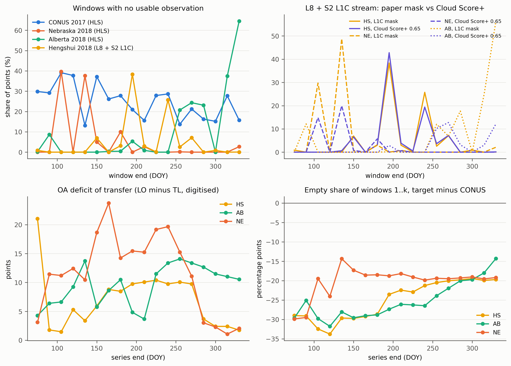

# Hao et al. 2020: are the target series emptier than the training pool?

Hao, Di, Zhang and Guo, Science of the Total Environment 733:138869 (2020), doi 10.1016/j.scitotenv.2020.138869.
A random forest trained on 8,448 CDL 2017 samples from 294 CONUS HLS tiles is applied in 2018 to Hengshui (North China Plain), Alberta and Nebraska from 15-day
maximum-NDVI composites. Full-season transferred OA is 97.79 (Hengshui), 86.45 (Alberta, local 96.55) and 94.86 (Nebraska, local 96.73); the deficit is larger for
shorter in-season series, and the authors attribute it to phenology, crop calendar, climate and irrigation. An empty window "is labeled as 'missing value'", then "filled with a moving window method by
calculating the average of the two neighboring high quality values" and Savitzky-Golay smoothed. No count of empty windows is reported and no code exists.
This audit measures how many windows are empty in each domain under that recipe and relates the differences to the paper's per-length OA gaps. No model is re-run.

## What the paper pins down (step 0)

Pinned: composite windows (15 days from DOY 60, 18 windows to DOY 330; Figs. 4, 6, 8 plot series ending at DOY 75 ... 330), the study boxes (Alberta 110-112W 52.5-54N, Nebraska 99-101W 40.5-42N, Hengshui 115-117E 37-39N),
the HLS tiles for Alberta (12UVD, 12UVE, 12UWD, 12UWE) and Nebraska (14TLL, 14TLM, 14TML, 14TMM), the sample design (100 km grid over CONUS, up to 30 pixels per crop and cell, CDL confidence 95, fields over 4 ha, class counts in Table 1),
the Hengshui stream (Landsat-8 SR plus Sentinel-2 L1C masked with "the cloud mask of the L1C product", 113 + 969 images) and the cropland mask (GFSAD30). Not pinned: the quality rule for HLS (no QA step is described), the L8 mask, the list of 294 tiles, the product version behind each
number (HLS v1.4). That is enough to measure empty windows; the quality rule for HLS is handled by reporting both an Fmask rule and no screening.

## Method

1. `01_digitise_figs.py` reads the overall-accuracy bars of Figs. 4, 6, 8 (TL and LO, 18 series lengths) against the y-axis labels. The 16 values quoted in the text agree within 1.0 point (mean absolute difference 0.5, `results/fig_text_check.csv`).
2. `02_points.py` reproduces the sample design on CDL 2017 in Earth Engine: 1,410 cells of 100 km in EPSG:5070, 30 random pixels per crop and cell (corn, soybean, cotton, spring wheat, canola, winter wheat incl. winter-wheat double crops), confidence at least 95, all 49 pixels of the 7 x 7 window of the same crop,
   then cut to the Table 1 class counts: 8,448 points (the 294-tile list is not given, so the points are spread over all CONUS cells). Nebraska: the same rule on CDL 2018 (1,200 corn, 800 soybean). Alberta: AAFC Annual Crop Inventory 2018 canola and spring wheat (1,000 each, 7 x 7 homogeneous, no confidence layer). Hengshui: GFSAD30 cropland, 3 x 3 homogeneous (2,000, no crop labels exist). Seed 42.
3. `03_ee_windows.py` counts, per point and window, the observations passing each rule. HLS v2.0 L30 + S30 (`NASA/HLS/HLSL30/v002`, `HLSS30/v002`): `obs` any reflectance, `fm` Fmask cirrus, cloud, adjacent and shadow bits clear (primary), `fmsnow` also snow-free. L8 C02 L2 + Sentinel-2 L1C for Hengshui: `paper` = L8 QA_PIXEL clear or L1C QA60 clear, `nomask`, and Cloud Score+ `cs65` / `cs80` (cs_cdf 0.65, 0.80) in place of QA60.
   Controls: the CONUS pool read in 2018, Nebraska and Alberta read in 2017 (year controls); Nebraska, Alberta and CONUS pushed through the Hengshui L8 + L1C stream (stream controls, about 670 to 940 points each).
4. `04_summarise_windows.py` (`haolib.fill_classes`) classifies each empty window as interior (valid windows exist before and after, so the two-neighbour average exists), edge (no value on one side) or strictly fillable (both adjacent windows valid), and counts runs of empty windows, per window, per domain, per crop and for the first k windows. Points that no HLS granule covers all season (3.1 percent of CONUS, 2.6 percent of CONUS@2018) are dropped as "tile not available".
5. `05_relate_oa.py` correlates the per-length LO-minus-TL OA gap with the target-minus-CONUS difference in empty share of the first k windows (Spearman, n = 18 per region, 54 pooled), against all CONUS points and against CONUS points of the crops each target grows.
6. `06_figure.py` draws `figures/hao_empty_windows_vs_oa_gap.png`.

## Results

Share of 15-day windows with no usable observation (DOY 60 to 330, primary rule; 95 percent bootstrap intervals are within +-0.01):

| Domain | Rule | Empty windows (share) | Early w1-5 (DOY 60-135) | Mid w6-11 | Late w12-18 | Interior-filled | Edge | Points with a run of 2+ | Points with a run of 3+ |
|---|---|---|---|---|---|---|---|---|---|
| CONUS 2017 (8,170 pts) | Fmask | 0.246 | 0.298 | 0.259 | 0.198 | 0.207 | 0.039 | 0.58 | 0.24 |
| Nebraska 2018 | Fmask | 0.054 | 0.155 | 0.029 | 0.004 | 0.053 | 0.002 | 0.02 | 0.00 |
| Alberta 2018 | Fmask | 0.103 | 0.018 | 0.012 | 0.243 | 0.051 | 0.052 | 0.35 | 0.00 |
| Hengshui 2018 | L8 QA + L1C mask | 0.049 | 0.002 | 0.086 | 0.052 | 0.049 | 0.000 | 0.06 | 0.02 |
| CONUS pool read in 2018 (control) | Fmask | 0.115 | 0.094 | 0.090 | 0.152 | 0.097 | 0.018 | 0.24 | 0.04 |
| Nebraska read in 2017 (control) | Fmask | 0.252 | 0.405 | 0.144 | 0.236 | 0.245 | 0.007 | 0.88 | 0.22 |
| Alberta read in 2017 (control) | Fmask | 0.323 | 0.586 | 0.153 | 0.281 | 0.188 | 0.135 | 0.92 | 0.15 |

With no quality screening (`obs`) the empty share is 0.022 for CONUS 2017, 0.000 for Nebraska and Alberta 2018, 0.000 for Hengshui. With snow also flagged (`fmsnow`) Alberta 2018 rises to 0.296 (0.609 in windows 1-5) and CONUS 2017 to 0.255. The same points give 0.115 (CONUS 2018) against 0.246 (CONUS 2017), and Nebraska and Alberta give 0.25 and 0.32 in 2017 against 0.05 and 0.10 in 2018, so the gap between training pool and targets follows the year, not the place.
CONUS points of the crops each target grows are alike (empty 0.20 for the Alberta crops, 0.26 for the Nebraska crops, 0.24 for the Hengshui crops).

Hengshui: empty windows are concentrated in the monsoon, DOY 180-195 (38 percent of points) and 225-240 (26 percent), not in the early season (0.2 percent in windows 1-5). Stream controls under the same L8 + L1C recipe give 0.047 (Nebraska), 0.072 (Alberta) and 0.145 (CONUS 2017, no Cloud Score+), so Hengshui is not emptier than the other places under its own stream.
Residual cloud: in windows that the L1C mask leaves non-empty, replacing QA60 with Cloud Score+ at 0.65 leaves 95.1 percent of Hengshui windows valid (same as the L1C mask), and the share of windows non-empty only through cloud-contaminated observations is 1.0 percent on average (up to 9 percent in DOY 180-195); Nebraska 0.4 and Alberta 0.8 percent.

Per-length transfer deficit (LO minus TL OA, digitised) averages 6.6 / 8.9 / 5.7 points (Hengshui), 8.0 / 7.5 / 12.4 (Alberta) and 9.7 / 17.7 / 7.8 (Nebraska) over series ending in windows 1-5, 6-11 and 12-18. The target-minus-CONUS difference in empty share is negative at every length and region (about -30 points for series of 1 to 5 windows, shrinking to about -20 at full length). Spearman correlations with the deficit are positive but weak (pooled n = 54: 0.33 for the empty share, 0.33 for the share of points with any empty window, 0.05 for runs of 2+; within regions -0.47 to 0.53); they come from a difference that is negative throughout and shrinks as series lengthen, while the deficit rises in the middle of the season.

## Finding

The hypothesis is refuted in its stated direction. Under the paper's recipe the 2017 CONUS training pool has more empty windows than any 2018 target: 24.6 percent of windows against 5.4 (Nebraska), 10.3 (Alberta) and 4.9 percent (Hengshui), with 58 percent of training points holding a run of two or more empty windows against 2 to 35 percent of target points, and the training emptiness concentrated in the early season (30 percent in DOY 60-135 against 0 to 16 percent). Hengshui's monsoon does empty windows at DOY 180-195 and 225-240, but its overall share is the lowest of the four, its L1C mask passes almost no extra cloud (1 percent of windows rest on contaminated observations), and the other places pushed through the same L8 + L1C stream look the same, so neither the sensor mix nor the coarse L1C mask creates a Hengshui gap.
The year controls show the training-pool emptiness is a 2017 versus 2018 contrast (the same CONUS points drop to 11.5 percent in 2018), so the shift in missingness exists but runs the other way: training series are more often interpolated than test series. The deficit does not line up with the difference either, because the largest transfer deficits sit in mid-season (Nebraska 17.7 points at windows 6-11) when the emptiness difference is not largest. The missingness-confound mechanism of our own paper (a target emptier than the training data) is therefore not supported here; a reverse mismatch (clean target, gap-filled training) is measured but its effect on the classifier is not tested, and the 2017 gaps depend on the product version (see Limitations). Verdict: refuted for the stated hypothesis, with an opposite-sign shift of unknown effect.

## Limitations

The data are HLS v2.0 in Earth Engine, not the v1.4 the authors used. v2.0 is a reprocessed archive with a newer Fmask (cloud, adjacent, shadow and snow handling differ) and its 2017 coverage is the sparse S2A-only period before Sentinel-2B ramped up, so the 2017 emptiness may differ from what v1.4 gave; the paper says no HLS quality step was applied, and the unscreened rule gives 2.2 percent empty in CONUS 2017, which is the lower bound.
The Fmask rule is a plausible reading, not the authors' rule, and in Alberta the answer depends on whether snow counts (0.103 against 0.296). The 294 tiles are unlisted, so the CONUS points cover all cells; Table 1 class counts are matched but the authors chose fields by eye, and 258 CONUS points (3.1 percent) lie outside EE HLS coverage and are dropped. The Hengshui stream uses L8 Collection 2 instead of the removed C01, L1C TOA with QA60 (no Sen2Cor L2A), the authors' unstated L8 mask is replaced by QA_PIXEL cloud, dilated cloud and shadow, and the image counts differ from their 113 and 969 (we find about 240 images in a chunk); Hengshui points are cropland, not labelled crops.
Points are a spatial sample, windows in a year are shared by all points (window-level emptiness is mostly weather, so one year per domain), and the stream controls use 670 to 940 points. A handful of points (under 1 percent) were not returned by the sampler and are absent. The OA values are digitised from bars to within 1 point, and the correlation uses 18 nested series lengths per region, so p-values are suggestive only.
