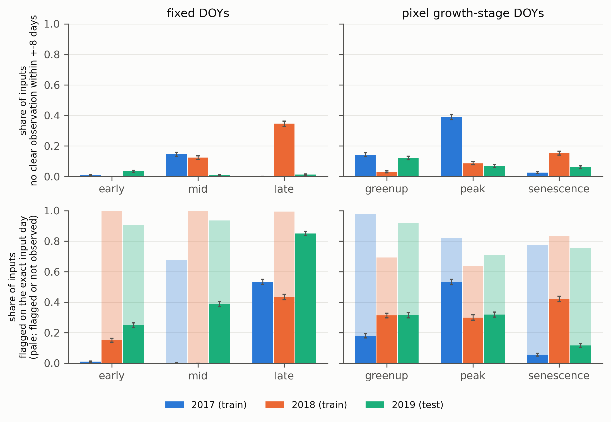

# Kerner audit: how often are the growth-stage and fixed-date inputs of Kerner et al. 2020 fills rather than observations, in training years versus the 2019 test year?

Kerner, Nakalembe, Becker-Reshef and others 2020 ("Rapid response crop maps in data sparse regions", arXiv [2009.10189](https://arxiv.org/abs/2009.10189)) train a corn, soybean and other classifier on Illinois HLS and Sentinel-1 time series from 2017 and 2018 and test it on 2019, a late-planting year. Fixed-date inputs lose 25 to 30 points of accuracy for the neural networks in 2019, growth-stage normalised inputs lose far less. The paper smooths each pixel series with a Savitzky-Golay filter "to fill in no-data pixels" and does not report how many inputs are filled. A desk check ([`research_notes/Missingness confound audit of transfer papers/kerner_refutation_and_specs.md`](../../../research_notes/Missingness%20confound%20audit%20of%20transfer%20papers/kerner_refutation_and_specs.md)) showed that the released growth-stage arrays contain no NaN, so nothing is zero-filled. What is left is the share of inputs that sit on a cloudy acquisition and are therefore interpolated values. This audit counts it, per year.

## What was measured

The released Zenodo archive (10.5281/zenodo.3997350, one 7.27 GB `data.zip`) is read by HTTP range requests; only the three phenology arrays (`data/phenology/16TBL_{year}_phenology.npy`, greenup, peak and senescence DOY per pixel) and the three CDL label arrays (corn 0, soy 1, other 2) are extracted, about 80 MB, with SHA-256 in `/mnt/bigdrive/external_audits/kerner/manifest.json`. For each year 2017, 2018 and 2019, 1000 pixels per class (3000 per year, 9000 in all) are drawn at random with seed 42 from CDL pixels whose three phenology DOYs are all at least 1 (DOY 0 marks no phenology). Pixel centres are placed on the HLS 16TBL grid (EPSG:32616, 30 m, upper left 199980, 4600020, read from Earth Engine).

For every pixel and every L30 (`NASA/HLS/HLSL30/v002`) and S30 (`NASA/HLS/HLSS30/v002`) acquisition of tile 16TBL in the year (2017: 56 L30 and 43 S30; 2018: 58 and 101; 2019: 51 and 98) Earth Engine returns one state: 0 not observed, 1 clear, 2 flagged when any Fmask bit 0 to 3 (cirrus, cloud, adjacent cloud or shadow, cloud shadow) is set. Bit 0 is reserved in v2.0: it is zero in all 24 images checked in `results/kerner_fmask_bit_check.csv`, so in practice the mask is cloud, adjacent cloud and shadow. Snow, water and aerosol bits are not masked, as in the paper. Per input (pixel, stage) the script counts clear acquisitions within plus or minus 8 days of the target DOY, and records the state on the exact target day (clear; flagged; or no acquisition observed that pixel that day). Targets are (a) the paper's fixed DOYs (2017: 153, 210, 274; 2018: 149, 209, 271; 2019: 152, 211, 274) and (b) each pixel's released greenup, peak and senescence DOY. The released phenology index equals the calendar DOY: offsets -1, 0 and 1 land on an acquisition day for 70, 65 and 3 percent (2017), 31, 92 and 69 percent (2018) and 18, 75 and 57 percent (2019) of pixels, and 0 is used for all years (`results/kerner_doy_offset.csv`). Intervals are 95 percent percentile bootstrap intervals over pixels, seed 42.

## How to run

```bash
conda activate ee
python experiments/external_audits/kerner/01_fetch_zenodo.py      # six members of the Zenodo zip by range request
python experiments/external_audits/kerner/02_hls_acquisitions.py  # acquisition list of tile 16TBL, Fmask cirrus-bit check
python experiments/external_audits/kerner/03_make_sample.py       # results/kerner_sample.csv, 3000 pixels per year
python experiments/external_audits/kerner/04_ee_pixel_states.py   # about 2 minutes, resumable by pixel; results/kerner_pixel_states.csv
python experiments/external_audits/kerner/05_summarise.py         # kerner_summary.csv, kerner_test_minus_train.csv, figures/kerner_fill_shares.png
```

Each script skips work whose output exists and takes `--force`. `run.sh` runs all five.

## Deviations from the paper

The paper used HLS v1.4 (inferred from the date of the work); this audit uses v2.0, the version in Earth Engine, which has a different acquisition set (for example no 2018 granule on DOY 209), Fmask 4 and revised corrections. The Savitzky-Golay smoother is not re-implemented, so fill share is measured by observation counts, not by comparing smoothed with raw values. The fixed-DOY arrays were not released, so fixed-date inputs are assumed to be samples of the same gap-filled series at the paper's DOYs. The sample is random over the whole tile, not the paper's homogeneity-masked training pixels or its validation quadrant.

## Results

Pixels per year: 3000 (1000 per class). "No clear" is the share of inputs with zero clear observations within plus or minus 8 days. "Flagged" is the share whose exact target day is flagged by Fmask. "Not observed" is the share with no HLS observation of that pixel on the exact day. Generated from `results/kerner_summary.csv`; stage rows and per-class rows are in the same file, and intervals are in `share_zero_clear_lo` and `_hi`.

| Year | Inputs | No clear in window | Median clear count | Flagged on exact day | Not observed on exact day | Clear on exact day |
|---|---|---|---|---|---|---|
| 2017 (train) | fixed DOY | 0.051 | 2 | 0.182 | 0.225 | 0.593 |
| 2018 (train) | fixed DOY | 0.156 | 3 | 0.195 | 0.802 | 0.002 |
| 2019 (test) | fixed DOY | 0.018 | 3 | 0.496 | 0.401 | 0.103 |
| 2017 (train) | growth stage | 0.185 | 2 | 0.256 | 0.602 | 0.142 |
| 2018 (train) | growth stage | 0.090 | 3 | 0.345 | 0.376 | 0.279 |
| 2019 (test) | growth stage | 0.084 | 2 | 0.250 | 0.544 | 0.206 |

By stage, the share with no clear observation in the window: fixed DOYs 2017 0.007, 0.146, 0.000; 2018 0.000, 0.123, 0.346; 2019 0.034, 0.008, 0.013 (early, mid, late). Growth stage: 2017 0.141, 0.390, 0.025; 2018 0.030, 0.086, 0.153; 2019 0.121, 0.069, 0.060 (greenup, peak, senescence). Classes differ little (corn, soy and other in 2019 fixed: 0.016, 0.016, 0.022; growth stage: 0.123, 0.072, 0.056). The largest class gap is corn greenup in 2019, 0.208 with no clear observation against 0.091 for soy and 0.065 for other.

2019 minus the pooled training years, from `results/kerner_test_minus_train.csv` (all stages and classes, interval in brackets):

| Inputs | No clear in window | Flagged on exact day | Not clear on exact day (flagged or not observed) |
|---|---|---|---|
| Fixed DOY | 0.104 train, 0.018 test, difference -0.086 [-0.091, -0.080] | 0.189, 0.496, +0.307 [+0.295, +0.319] | 0.703, 0.897, +0.194 [+0.184, +0.205] |
| Growth stage | 0.137 train, 0.084 test, difference -0.054 [-0.061, -0.046] | 0.301, 0.250, -0.051 [-0.063, -0.038] | 0.789, 0.794, +0.004 [-0.006, +0.015] |



## Finding

The count does not show that 2019 inputs are more often fills than training inputs. Within plus or minus 8 days of the target, 2019 inputs have no clear HLS observation less often than training inputs for both fixed DOYs (0.018 against 0.104, with 2017 at 0.051 and 2018 at 0.156) and growth-stage DOYs (0.084 against 0.137, with 2017 at 0.185 and 2018 at 0.090), and the median input has 2 to 3 clear observations in the window in every year. Two cells go the other way and both are small: the early fixed date (0.034 of 2019 inputs with no clear observation against 0.007 and 0.000 in 2017 and 2018) and corn greenup (0.208 against 0.095 in training); no other stage in 2019 exceeds the worse training year. On the exact target day the picture splits by basis: for growth-stage inputs the share not clear is the same in 2019 as in training (0.794 against 0.789, difference +0.004 with interval -0.006 to +0.015), and for fixed DOYs 2019 is higher than the training mean (0.897 against 0.703) but sits between 2017 (0.407) and 2018 (0.998), so the training mixture already spans it. The 2019 fixed dates are flagged more often (0.496 against 0.189) because in 2018 most fixed-date pixels have no acquisition at all in v2.0.

So a fill-versus-observation shift between the training years and 2019 is not supported at any level that is large against the shifts already inside the training years, and it cannot account for the 25 to 30 point collapse of the fixed-date neural networks by being specific to 2019. This refutes the fill-share confound for this paper at the level of observation counts; the parts left unmeasured are the actual smoothing and the v1.4 acquisitions.

## Limitations of this audit

The data are HLS v2.0, not the v1.4 the authors almost certainly used, so cloud flags, acquisition days and the share of days with no observation differ from what the authors' smoother saw; the exact-day columns are the most exposed to this, since 29 to 80 percent of growth-stage target days have no v2.0 observation of the pixel although the authors' time series contained that date, and I therefore treat the plus or minus 8 day window as the primary measure. The plus or minus 8 day window is a stated proxy for how far a Savitzky-Golay fill reaches, not the authors' filter, whose window and order are not published. The fixed-DOY inputs are inferred, not released. The 2017 phenology is degenerate (greenup DOY 186 for most pixels), so the 2017 growth-stage rows describe a near-fixed-date input. The samples are 1000 pixels per class per year over the whole tile, intervals reflect pixel sampling only and ignore spatial correlation and the uncertainty in the cloud mask, and Sentinel-1 channels (gap-free) are not examined. Nothing here re-runs the classifiers, so the audit shows that the fill share is not higher in 2019, not what the accuracy loss is caused by.
