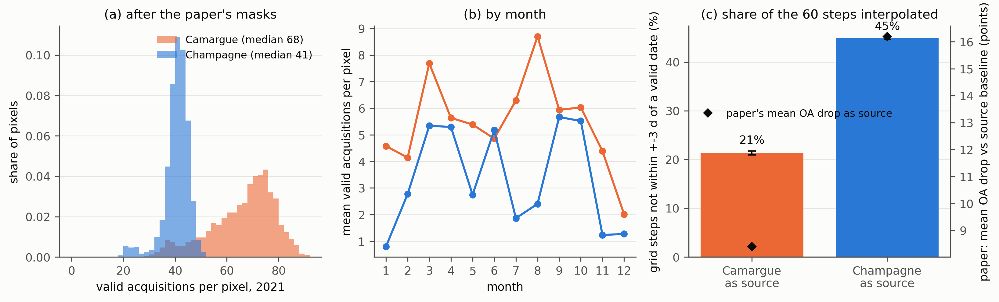

# Maleki and Rahdari 2026 audit

Paper: Maleki and Rahdari, Remote Sensing 18:1234 (2026), doi 10.3390/rs18081234. Wetland classifiers (open water, aquatic vegetation, terrestrial vegetation; RF, XGBoost, MLP, InceptionTime) are trained on one of the Camargue or the Etangs de la Champagne humide and tested on the other, 2021 Sentinel-2 only. The card in the audit report predicted that the Champagne series is far more interpolated than the Camargue one, so the larger drop should fall when Champagne is the source. This audit measures the interpolation per site. No model is re-run.

## What the paper fixes

Section 2.2.2: Level-2A via Google Earth Engine, 2021, granules with `CLOUDY_PIXEL_PERCENTAGE < 50`, pixels masked with `MSK_CLDPRB < 1`, `MSK_SNWPRB < 10` and SCL (clouds, cirrus, cloud shadows, dark areas, taken as classes 2, 3, 8, 9, 10), gaps filled by linear interpolation, 60 observations on a 6-day grid from 1 January to 31 December. The product (`S2_SR_HARMONIZED` or the deprecated `S2_SR`) is not named; both give identical 2021 granule and date counts, so it does not matter here. Extents are the two Ramsar outlines of Figure 1; WDPA polygons (`WCMC/WDPA/current/polygons`, Ramsar) give 843.9 and 2557.9 km2 against the 850 and 2558 reported there. Polygon labels (CARHAB) are not used; WorldCover 2021 classes stratify the points instead.

## Method

`01_site_geometry.py` stores the polygons and inventories granules, MGRS tiles, orbits and cloud-filtered acquisition dates. `02_sample_validity.py` draws 2000 random points per site (seed 42, 10 m) and records, for every acquisition date (same-day granules merged by max), whether the pixel is covered, valid under the paper's full mask, and valid under SCL alone. `03_interp_metrics.py` computes per pixel the valid count, the monthly counts and, on the 60-step grid (days 1, 7, ..., 355), the share of steps with no valid date within +-3 days (these are the interpolated or extrapolated steps), the longest run of such steps and the longest gap between valid dates, with 1000-draw bootstrap intervals over points. `04_summarise.py` joins the paper's Tables 4 and 5 and draws the figure. Pure functions are in `interplib.py`; tests in `tests/test_maleki_interplib.py`.

## Results

| Measure (paper masks, 2000 points) | Camargue | Champagne |
|---|---|---|
| Polygon area, km2 | 843.9 | 2557.9 |
| Granules with cloud < 50 / all (2021) | 277 / 436 | 169 / 429 |
| Distinct acquisition dates after the granule filter | 106 | 71 |
| Orbits | 8, 108 | 8, 51 |
| Valid acquisitions per pixel, median (p10 to p90) | 68 (47 to 79) | 41 (35 to 45) |
| Same, SCL only / no mask (covered) | 79 / 95 | 44 / 55 |
| Grid steps not within +-3 d of a valid date, mean (95% CI) | 21.4% (21.0 to 21.8) | 44.9% (44.6 to 45.2) |
| of which extrapolated at the year edges, steps | 1.6 | 3.1 |
| Longest unobserved run on the grid, median | 2 steps (12 d) | 5 steps (30 d) |
| Longest gap between valid dates, median (days) | 20 | 35 |
| Pixels with more than 20 of 60 steps interpolated | 10.8% | 98.3% |

Monthly mean valid acquisitions per pixel (`results/monthly_valid.csv`): Champagne falls to 0.8 in January, 1.9 in July, 2.4 in August, 1.2 and 1.3 in November and December; Camargue's lowest are 2.0 in December and 4.1 to 4.6 in January to February. WorldCover strata within a site differ by at most 0.08 in interpolated share (Camargue water 18.5%, herbaceous wetland 25.5%, cropland 22.7%; Champagne 43 to 46% in all classes), so the site gap is not a land-cover composition effect. The paper's mask costs about a quarter of the covered observations at both sites (95 to 68 and 55 to 41), so it does not itself create the contrast.

Paper OA (Tables 4 and 5, mean of 12 algorithm by feature configurations): Camargue to Champagne 84.7%, Champagne to Camargue 79.2%. The quoted OA reductions of 3.8 to 16.9 and 11.0 to 23.8 points reproduce only against the baseline of the source (training) site, not the target site as the text says; mean reduction is 8.4 for Camargue as source and 16.2 for Champagne as source (against the target baseline 10.8 and 13.8, so the direction ordering holds either way). Table 4 differs from the text in two cells (IT bands 76.9 versus 76.5, MLP indices 80.5 versus 80.4). Full numbers: `results/maleki_direction_table.csv`.

## Finding

The hypothesis holds on the measurement. Champagne is the sparser site on every statistic: median 41 valid acquisitions per pixel against 68, 45% of the 60 grid steps interpolated against 21%, a 30-day against 12-day median longest unobserved run, and near-empty winter and midsummer months (0.8 valid dates in January, 1.9 in July). Almost every Champagne pixel (98%) has more than a third of its series interpolated, against 11% in Camargue. The asymmetry the authors report matches the more-interpolated-source, cleaner-target pattern: the Champagne-trained, Camargue-tested direction loses more (mean 16.2 versus 8.4 points against the source baseline, 79.2% versus 84.7% OA), and in it the model learns from series that are mostly linear interpolation and is then applied to series with sharp real dynamics. The paper attributes the asymmetry to distributional mismatch and hydrology and reports no valid-observation counts, so interpolation density is an uncontrolled alternative explanation, not a demonstrated cause. Camargue is not simply cleaner by cloud: it is covered by two orbits that overlap on its tiles and has 106 against 71 acquisition dates after the granule filter, and the Camargue pixel series are also denser before any mask (95 against 55 covered dates). The card's wording, that the Champagne series is far more interpolated, is confirmed; the claim that this predicts the observed asymmetry is supported in direction only.

## Limitations

There are two sites and two directions, so the match between interpolation and drop is one comparison and cannot be tested statistically; hydrology and class composition differ as well, and the drop is also confounded with each site's own within-site baseline. The measurement is on random pixels in the whole Ramsar polygon, with WorldCover strata, not on the CARHAB polygon means (median 600 to 1060 m2) the authors trained on, and I could not retrieve their mask, grid origin or footprint code (the repository has classifiers only): the grid start (1 January, step 6), the closed +-3 day window, the SCL class list and the merge of same-day granules by max are my reading of the text. Champagne has few water points (85) and no wetland stratum large enough, so aquatic vegetation, the paper's hardest class, is only covered through the Camargue wetland stratum. The audit shows how much of each series is interpolated, not how interpolation changes the classifiers' errors; nothing here re-runs the paper's models.
