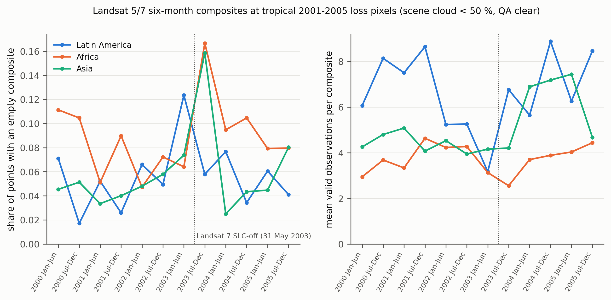

# Masolele audit: do the three continents' Landsat composites differ in emptiness?

Masolele et al. 2021 (RSE 264:112600, [10.1016/j.rse.2021.112600](https://doi.org/10.1016/j.rse.2021.112600); open access [edepot.wur.nl/551332](https://edepot.wur.nl/551332)) classify land use following deforestation in Latin America, Africa and Asia from twelve Landsat 5 and 7 median composites (January to June and July to December, 2000 to 2005), built in Google Earth Engine from scenes under 50 percent cloud after a QA-band cloud filter. They find that "all models performed better when the scope of the problem was limited to a single continent". The paper never says what a pixel receives when a six-month window has no valid observation (an Earth Engine median of an empty stack is masked) and reports no cloud or gap statistic per continent. No code or data deposit was found.

## What was measured

The labelled sample units (De Sy et al. 2019, on the FAO FRA-2010 Remote Sensing Survey: 10 by 10 km units at every 1° confluence point, restricted to Hansen et al. 2013 loss from 2000 to 2005) are not public. As a stand-in, `01_points.py` takes every confluence point with latitude between 23°S and 23°N in three longitude bands (Latin America 118°W to 34°W, Africa 18°W to 51°E, Asia 60°E to 155°E), draws 20,000 pixels from the 10 by 10 km unit around it, keeps those with Hansen `lossyear` 2001 to 2005 (`UMD/hansen/global_forest_change_2023_v1_11`) and retains up to three per unit (seed 42). That gives 7,330 points in 2,597 units: 2,972 in 1,057 Latin American units, 2,838 in 992 African and 1,520 in 548 Asian.

`02_window_counts.py` counts, for each point and each of the paper's twelve windows, the Landsat 5 and 7 Collection 2 Level 2 observations from scenes with `CLOUD_COVER` below 50 whose `QA_PIXEL` cloud and cloud-shadow bits are clear and whose six SR bands are all unmasked, so that SLC-off stripes count as missing. A window with zero valid observations is one whose median composite is empty. Collection 1 SR, which the paper used, is retired in Earth Engine, and Collection 2 is its successor.

## How to run

```bash
conda activate ee
bash experiments/external_audits/masolele/run.sh   # 01 points (~3 min), 02 counts (~5 min), 03 summary and figure
```

## Results

Per continent, all twelve windows pooled (`results/continent_summary.csv`):

| Continent | Points | Empty composites (share of point-windows) | Points with at least one empty composite | Empty composites per point (of 12) | Mean valid obs per composite | Composites with at most one valid obs |
|---|---|---|---|---|---|---|
| Latin America | 2,972 | 5.6 % | 28.6 % | 0.68 | 6.7 | 13.9 % |
| Africa | 2,838 | 8.9 % | 40.3 % | 1.07 | 3.7 | 24.2 % |
| Asia | 1,520 | 5.8 % | 36.6 % | 0.70 | 5.1 | 16.8 % |

By window (`results/window_summary.csv`), the empty share peaks in July to December 2003, the first half-year after Landsat 7's scan-line corrector failed, at 16.7 percent in Africa and 15.9 percent in Asia, against 5.8 percent in Latin America.



## Finding

The three continents do differ in composite completeness, but less than the report card assumed. Africa is the sparsest: 8.9 percent of its six-month composites are empty and 40 percent of its loss pixels have at least one empty composite in the twelve, against 5.6 and 29 percent in Latin America, and an African composite rests on 3.7 valid observations on average against 6.7 in Latin America. Asia is not sparser than Latin America in empty composites (5.8 against 5.6 percent), although its composites hold fewer observations (5.1). The largest contrast between continents in the empty share is 1.6 times.

The full text then removes the premise of the card. The paper never tests a model outside the region it was trained on. Each continental model is trained and tested on random 75/10/15 splits of its own continent, and the pan-tropical model on random splits of all three pooled, and Fig. 4 reports the pan-tropical model only on the pooled test set, not per continent. "Continental models perform better" is therefore a comparison of different test sets with different class mixes (pasture is 72 percent of Latin America's samples, small-scale cropland 57 percent of Africa's), not a transfer loss. Under the audit rubric a paper that reports no transfer score is rank 1 (N/A), as Huppertz 2021 was. The measurement also runs against the card's mechanism where it can be checked: in Fig. 4 the best continental models reach roughly 75 to 80 percent macro F1 on Africa and Asia but only roughly 55 to 60 percent on Latin America, the continent with the fullest composites.

## Limitations of this audit

The points are Hansen 2001 to 2005 loss pixels at every tropical confluence unit, not the De Sy et al. units, which also cover subtropical countries and are weighted toward units the interpreters labelled; the three-points-per-unit draw weights every unit with loss equally. Collection 2 surface reflectance and its `QA_PIXEL` mask stand in for the Collection 1 SR and `pixel_qa` band the paper used, and the paper's exact QA rule is not stated, so absolute empty shares may differ; the comparison between continents uses one rule throughout. What the authors' export wrote into an empty composite (a constant, zero, or a skipped sample) cannot be recovered without their code. The Fig. 4 values quoted in the Finding are read by eye from the bar chart.
