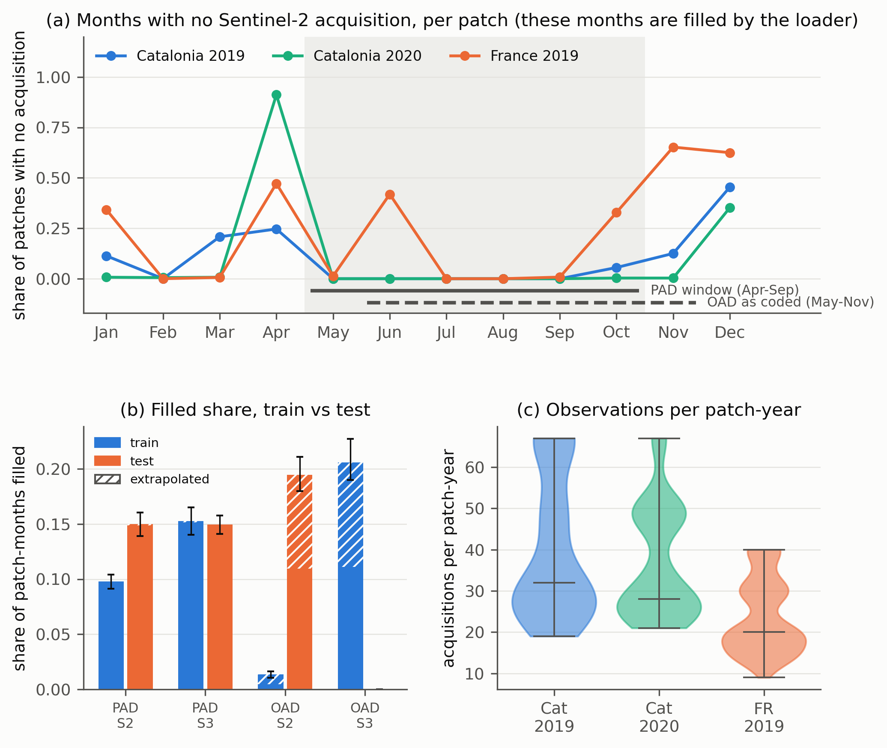

# Sen4AgriNet audit: which months does the loader fill, and does it differ between source and target domains?

Sykas, Sdraka, Zografakis and Papoutsis 2022 (IEEE JSTARS 15, [10.1109/JSTARS.2022.3164771](https://doi.org/10.1109/JSTARS.2022.3164771)) keep Sentinel-2 L1C scenes under a 10 percent granule cloud filter, apply no pixel cloud mask, and train on monthly medians. Scenario 2 trains on Catalonia 2019 and 2020 and tests on France 2019; Scenario 3 trains on France 2019 and tests on Catalonia 2020. The authors' loader fills every month that has no acquisition with `interpolate_na(method='linear', fill_value='extrapolate')`, which the paper does not describe, and attributes the transfer drops to phenology and label imbalance. This audit rebuilds the measurements that the earlier reading of the paper relied on (scratch scripts that were deleted) in reproducible form. No model is run and no downloaded code is executed.

## What was measured

Step 01 fetches the exact source files at pinned commits (Orion-AI-Lab/S4A-Models `ae5a376`, Orion-AI-Lab/S4A `7ac66dc`), records SHA-256, and extracts the line ranges behind each code fact into `results/code_facts.csv`, with a regular expression per fact that must match its lines (all 12 do). The facts are: the calendar-month median with right-closed bins (`PAD_dataset.py` 293 to 299), the resample and `interpolate_na` chain with no `max_gap` (301 to 307), the same chain in the median exporter, the OAD CSV builder and the S4A loader, the OAD window slice (`OAD_datamodule.py` line 53, month indices 4 to 10, May to November), the OAD datamodule reading `{stem}_test.csv.gz` for fit, validate, test and predict (lines 90 to 117), and the mask flags defaulting to off (`pad_experiments.py` 167 to 175). The docstring of `PAD_dataset.py` (lines 31 to 38) describes a different fill (median of neighbouring bins, replication at the edges) from what the code does.

Step 02 streams the authors' Dropbox `S4A-Models.zip` (13.7 GB) once. Dropbox builds that archive on the fly and ignores Range requests, so a central-directory range read is not possible (a Range request returned the whole body); the members are stored, uncompressed, so a forward-only parser (`zipstream.py`, unit-tested on synthetic archives including data descriptors) skips unwanted members as they pass and keeps only the nine COCO split files and the three OAD `*_test.csv.gz` files (the train and val CSVs, 0.7 to 2.3 GB each, and the model weights are skipped). The pass takes about six minutes; `results/zip_member_listing.csv` lists all 44 members and `manifest.json` holds the SHA-256 of the 12 kept files.

Step 03 reads the image lists of the COCO files (`results/split_patches.csv.gz`, `split_composition.csv`; sizes match the published ones: Scenario 2 train 3025 and test 1014 patches, Scenario 3 train 3000 and test 1003). Step 04 reads the `B02/time` axis of 657 patch NetCDFs from the Hugging Face dataset `orion-ai-lab/S4A` (pinned revision `4eb4415`) by HTTP range requests through h5py and fsspec, 25 random patches per scenario, split and tile-year (seed 42; 675 draws, 657 distinct files), for Scenarios 2 and 3, train and test.

Step 05 applies the fill rule to each patch-year in `fillrule.py`, a pure re-implementation: acquisitions are binned into calendar months with intervals (start, end]; a month with none is filled; it is interpolated if a month with data lies on both sides and extrapolated otherwise. Stored stacks contain only acquisitions with complete coverage and no NaN pixels, so the fill is patch-wide. The summary is weighted so each tile-year counts in proportion to its patches in the published split, with 95 percent bootstrap intervals (300 stratified resamples of the sampled patches, seed 42). Windows are PAD (April to September, `--fixed_window`) and OAD as coded (May to November).

Step 06 cross-checks against the OAD test CSVs (309,010 France 2019 parcels for Scenario 2, 329,839 Catalonia 2020 parcels for Scenario 3). The CSVs hold the already-filled monthly parcel means of 13 bands, so a month is inferred to be filled when all 13 band means lie on the time-weighted line through other months within 1e-6 and the whole pattern is consistent (`fillrule.infer_filled`, tested by simulating the fill rule on random presence patterns). Step 07 (optional context) counts Earth Search STAC `sentinel-2-l1c` granules per tile-year and month, total and with `eo:cloud_cover` below 10. Step 08 writes the summary tables and the figure.

## How to run

```bash
conda activate ee
bash experiments/external_audits/sen4agrinet/run.sh          # about 30 minutes, 5 GB of downloads under /mnt/bigdrive/external_audits/sen4agrinet
python experiments/external_audits/sen4agrinet/99_cleanup.py  # deletes the downloads, keeps manifest.json
```

Each numbered script skips work whose output exists and takes `--force`. Seed 42 throughout.

## Deviations from the earlier scratch analysis

The earlier sample was about 979 files; this one is 657 (25 per scenario, split and tile-year, train and test only, no validation split), so the intervals are wider. Scenario 1 is not analysed. The earlier "11 study classes" CSV subset is replaced by "label > 0" because the label-to-class mapping is not in the deposited files. The month in which an extrapolated or interpolated fill is placed is not fully identifiable from the CSV means when a valid month at the edge happens to be collinear with its two neighbours (for example a valid October, a filled November and a valid December cannot be told from a valid October and November with an extrapolated December); the inference breaks such ties towards extrapolation. The fill count is identifiable, which is why the window totals below agree, but per-month CSV shares differ somewhat from the earlier ones (April 46 percent here against 36 percent earlier for Scenario 2; June 38 against 45; November 61 against 42).

## Results

Share of patch-months filled in the window (patch time stacks, weighted by split composition). Earlier value in the last column.

| Scenario | Window | Train filled (95% CI) | Train extrapolated | Test filled (95% CI) | Test extrapolated | Earlier train / test |
|---|---|---|---|---|---|---|
| 2 (Cat to FR) | PAD Apr-Sep | 9.8% (9.1 to 10.4) | 0.0% | 15.0% (13.9 to 16.0) | 0.1% | 9.8 / 14.9 |
| 3 (FR to Cat 2020) | PAD Apr-Sep | 15.3% (14.0 to 16.5) | 0.1% | 15.0% (14.1 to 15.8) | 0.0% | 15.8 / 15.0 |
| 2 (Cat to FR) | OAD May-Nov | 1.4% (1.1 to 1.6) | 0.9% | 19.5% (18.0 to 21.1) | 8.5% | 1.4 / 19.8 |
| 3 (FR to Cat 2020) | OAD May-Nov | 20.6% (19.0 to 22.7) | 9.5% | 0.0% | 0.0% | 20.7 / 0.0 |

Share of patches with at least one filled month: PAD 58.6 percent (Scenario 2 train), 65.2 (Scenario 2 test), 65.1 (Scenario 3 train), 89.7 (Scenario 3 test); OAD 9.2, 91.1, 90.5 and 0.0 percent. The rebuild differs from the earlier values by at most 0.5 points (`results/rebuild_vs_earlier.csv`). The earlier OAD Scenario 2 extrapolated share of 9.3 percent is 8.5 here (CI not computed for this component); the cause was not traced, and it may be the different sample or the weighting.

Share of patches with no acquisition in a month (`results/month_missing_by_country_year.csv`, per tile-year in `month_missing_by_tile_year.csv`):

| Domain | Jan | Mar | Apr | Jun | Oct | Nov | Dec |
|---|---|---|---|---|---|---|---|
| Catalonia 2019 | 0.11 | 0.21 | 0.25 | 0.00 | 0.06 | 0.13 | 0.45 |
| Catalonia 2020 | 0.01 | 0.01 | 0.91 | 0.00 | 0.00 | 0.00 | 0.35 |
| France 2019 | 0.34 | 0.01 | 0.47 | 0.42 | 0.33 | 0.65 | 0.62 |

Observations per patch-year (`results/obs_by_country_year.csv`, sampled patches, unweighted): Catalonia 2019 mean 40.3 (range 19 to 67), Catalonia 2020 37.1 (21 to 67), France 2019 24.0 (9 to 40).

OAD CSV cross-check (`results/oad_csv_crosscheck.csv`, parcel-weighted, all rows): Scenario 2 test (France 2019) 14.2 percent of PAD-window and 17.5 percent of OAD-window parcel-months filled, 9.9 percent extrapolated in the OAD window; Scenario 3 test (Catalonia 2020) 15.7 percent and 0.06 percent, with April filled in 94.5 percent of parcels. These are within 2 points of the patch-based test values above (the CSV is parcel-weighted and the patch table is patch-weighted), and the earlier CSV values (14.2, 17.5, 15.7, 0.1) are reproduced.

STAC context (`results/stac_vs_patch_presence.csv`): of 192 tile-year-months, the rule "no granule under 10 percent cloud" and "at least half of the patches empty" agree in 89.6 percent. The disagreements are months with a few clear granules but patches still empty (for example Catalonia 2020 April, 31TBF, 12 granules, 1 clear, 100 percent of patches empty), consistent with edge patches losing acquisitions that do not cover them fully.



## Finding

The undescribed fill is real, it fires on the published inputs, and what differs between source and target is the months it fills, not always the rate. In the PAD window (April to September) Scenario 2 has 9.8 percent of patch-months filled in the Catalonia training set against 15.0 percent in the France test set, while Scenario 3 has 15.3 and 15.0 percent, equal within sampling error. The equal rate hides different months: Catalonia 2020 has no acquisition in April in 91 percent of patches and almost never in June, whereas France 2019 is empty in April in 47 percent and in June in 42 percent, and France has about 24 observations per patch-year against 37 to 40 in Catalonia. In the OAD window as coded (May to November, not April to September) the asymmetry is large in both directions: 1.4 percent filled in the Scenario 2 training set against 19.5 percent in the test set (8.5 percent extrapolated, from October to December), and 20.6 percent in the Scenario 3 training set against none in the test set. These rebuilt numbers agree with the earlier ones to within half a point, and the OAD test CSVs reproduce them independently.

This does not show that the fill causes the drops: the filled months (April, June) are also where the phenology shift sits, the Scenario 3 PAD rates are equal yet it is the worst PAD result, and the label shift between regions is large. It does mean that the paper's attribution to phenology and label imbalance leaves a measured input difference unaccounted for in Scenario 2 and in both OAD scenarios, and that "different months filled" is a better statement of the confound than "different fill rates". Separately, the released `OAD_datamodule.py` loads the `_test` CSV for fit, validate and test alike; whether the published OAD results used it cannot be settled from the files (the bundle contains no OAD weights), but if they did, Table IV would not be a transfer result at all.

## Limitations of this audit

The patch-level rates come from 657 sampled patches (25 per scenario, split and tile-year), weighted by split composition, so the intervals reflect patch sampling only; the full 7,659 patches were not read. The fill rule is re-implemented from the code and the description of the xarray call, not run, and was checked by simulation and against the OAD CSVs rather than against the authors' arrays; the CSV inference cannot place a fill at the edge of a series when a valid month is collinear with its neighbours, so per-month CSV shares are less reliable than the window totals. The 10 percent granule filter is reproduced only approximately by STAC, and the field the authors used is not stated. Nothing here re-runs any model, so it cannot apportion the transfer losses between missingness, phenology and label shift, and it cannot say which datamodule the published OAD runs used.
