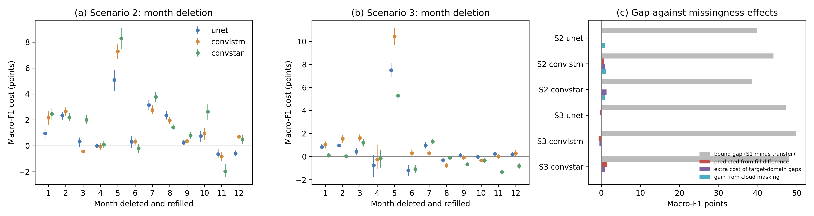

# Sen4AgriNet re-run: do the domains' different empty months explain the PAD transfer drops?

The descriptive audit in `../sen4agrinet/` showed that the authors' loader fills every month without an acquisition by linear interpolation or extrapolation, which the paper never describes, and that the filled months differ between source and target (Catalonia 2020 has no April acquisition in 91 percent of patches; France 2019 is empty in April in 47 percent and June in 42 percent). It could not say whether that difference costs accuracy. This folder tests it with the authors' released PAD checkpoints (U-Net, ConvLSTM and ConvSTAR; Sykas et al. 2022, [10.1109/JSTARS.2022.3164771](https://doi.org/10.1109/JSTARS.2022.3164771); code [Orion-AI-Lab/S4A-Models](https://github.com/Orion-AI-Lab/S4A-Models) at commit ae5a376; data [orion-ai-lab/S4A](https://huggingface.co/datasets/orion-ai-lab/S4A) at revision 4eb4415). Nothing is retrained: the frozen models are evaluated on every test patch of their scenario under test-time interventions on the monthly inputs.

## What was done

Scenario 2 trains on Catalonia 2019 and 2020 and tests on France 2019 (1,014 patches); Scenario 3 trains on France 2019 and tests on Catalonia 2020 (1,003 patches). Scenario 1, the random split (1,000 patches), is run as published to give the in-domain bound. Inputs are rebuilt with the authors' monthly median and fill rule (`rerunlib.monthly_filled`, verified equal to their exporter to floating-point precision), and each patch is scored with a confusion matrix under the authors' test metric and under a corrected one.

**The released checkpoints do not see what the paper describes.** The authors' exporter (`export_medians_multi.get_medians`) returns a transposed, non-contiguous array, and the sliding-window step that follows uses `as_strided`, which assumes C order. Input slot (t, b) therefore holds band (4t+b) // 12 at month (4t+b) mod 12, so the six-month window the paper describes (April to September, four bands) actually feeds the models B03 for all twelve months followed by B04 for all twelve months. B02 and B08 are never seen. This is what the checkpoints were trained on: with this layout, they reproduce all nine README weighted-F1 values to within 0.02 points, while with the intended layout they score 7 to 16. Every condition below uses the layout the checkpoints were trained on (`rerunlib.export_slots`), so every one of the twelve months, including the extrapolated January, November and December, enters the models.

**The authors' test metric** casts log-softmax outputs to integer (truncation) before exponentiating and taking the argmax, and drops label and prediction 0 (background) before computing F1. It is reproduced exactly for the gate (`f1w_authors`). The intervention contrasts use corrected weighted and macro F1 (`f1w_corrected`, `f1m_corrected`): background predictions on parcel pixels count as errors, and a class with no prediction scores 0, not NaN. The authors' arithmetic returns NaN on any subset where some class gets no prediction, which makes it unusable for subsets and bootstrap draws.

Conditions in Scenarios 2 and 3:
- **Month deletion** (`del_m1` to `del_m12`): every acquisition of month m is deleted from patches that have one, and the month is refilled by the authors' rule. The cost of m is published F1 minus deleted F1 on those patches.
- **Gap-pattern imposition**: the empty-month pattern of a randomly drawn training-domain patch (`src`) or test-domain patch (`tgt`) is imposed, by deleting this patch's months that the drawn patch lacks. A matched-random control (`rnd`) deletes as many months as `src` did, chosen at random. Patterns come from the descriptive audit's sampled time stacks, 5 draws per patch, seeded by scenario and patch so they are identical across models.
- **Cloud masking** (`cloud`): the authors' own `utils/tools.hollstein_mask` (clouds only) is applied per acquisition before the median, so cloudy pixel-months fall back to the fill.
- **Predicted share**: for each month, the test-minus-train empty-month rate is multiplied by that month's deletion cost and the products are summed. This is the loss the fill difference would cause if missingness acted month by month, set against the bound gap (Scenario 1 minus transfer).

Intervals are 95 percent patch bootstraps (500 draws, seed 42) of F1 computed from summed confusion matrices, which is the same statistic the authors report.

## How to run

```bash
bash experiments/external_audits/sen4agrinet_rerun/run.sh   # env deep_field (GPU)
```

The authors' modules import pytorch-lightning 1.6, tensorboardX, pycocotools and scikit-multilearn. `stubs/` replaces these for inference only, and checkpoints are unpickled with placeholder classes for the Lightning callbacks (`evalcore.load_checkpoint`). Test NetCDFs (74 GB) and weights live under `/mnt/bigdrive/external_audits/sen4agrinet_rerun/`. Keep `--workers` near 16 or lower: unbounded input building exhausted 64 GB of RAM before the bounded queue in `02_run_conditions.py` was added. Not part of `../run_all.sh`.

## Results

Gate (`results/reproduction.csv`): with the authors' metric, all nine README weighted F1 values are reproduced to within 0.02 points (Scenario 1: U-Net 82.60, ConvLSTM 85.18, ConvSTAR 80.38; Scenario 2: 57.87, 56.56, 52.15; Scenario 3: 43.55, 40.47, 34.45). Corrected macro F1 is 66 to 72 in Scenario 1, 28 to 30 in Scenario 2 and 18 to 22 in Scenario 3, so the bound gap is 39 to 44 macro-F1 points in Scenario 2 and 47 to 50 in Scenario 3 (`results/bound_gap.csv`).

Corrected macro F1, all test patches (`results/pattern_imposition.csv`, `results/cloud.csv`, `results/predicted_share.csv`):

| | Scenario 2 (Catalonia to France) | | | Scenario 3 (France to Catalonia) | | |
|---|---|---|---|---|---|---|
| | U-Net | ConvLSTM | ConvSTAR | U-Net | ConvLSTM | ConvSTAR |
| Published | 29.9 | 28.0 | 27.8 | 22.5 | 22.3 | 18.2 |
| Source-domain gaps imposed | 29.9 | 27.8 | 27.4 | 22.6 | 21.8 | 19.5 |
| Target-domain gaps imposed | 29.6 | 26.8 | 26.1 | 22.6 | 22.3 | 18.5 |
| Matched random deletion | 28.9 | 26.6 | 26.5 | 19.8 | 19.0 | 16.9 |
| Extra cost of target gaps (source minus target) | +0.3 | +1.0 | +1.3 | -0.1 | -0.4 | +1.0 |
| Cloud masked | 30.8 | 29.2 | 28.7 | 22.6 | 22.4 | 18.4 |
| Predicted loss from fill difference | 0.1 | 0.8 | 0.2 | -0.4 | -0.7 | 1.5 |
| Bound gap | 39.8 | 44.1 | 38.5 | 47.2 | 49.8 | 48.1 |

Imposed patterns deleted 0.6 months per patch on average for source patterns and 1.4 for target patterns in Scenario 2. In Scenario 3 the direction reverses: 2.2 months for source patterns against 0.3 for target patterns, because the France training domain is the gappier one, and the source pattern is no worse than the target pattern. Matched random deletion costs more than either domain's pattern in Scenario 3 (by 1.6 to 3.3 macro-F1 points relative to the target pattern), so the domains' typical gaps fall in months the models can do without.

Month deletion (`results/month_deletion.csv`): May is the one month that matters, costing 5.1 to 8.3 macro-F1 points in Scenario 2 and 5.3 to 10.4 in Scenario 3 when deleted and refilled. Other months cost -2 to +4 points. May is present in nearly every patch of both domains. April, which Catalonia 2020 lacks in 89 percent of its test patches, costs -0.8 to -0.2 points in Scenario 3 on the 113 patches that have it. The 113 patches with all twelve months behave like the full set (`complete_year` rows).

Cloud masking with the authors' Hollstein rule raises corrected weighted F1 by 1.8 to 2.0 points in Scenario 2 (macro F1 0.9 to 1.2) and by 0.1 to 0.3 points in Scenario 3. Corrected weighted-F1 versions of every table are in the same files.



## Finding

The undescribed fill does not explain Sen4AgriNet's PAD transfer drops, so the paper moves to rank 2. With the authors' own models, making the test inputs carry the training domain's gaps, or the reverse, moves macro F1 by at most 1.3 points against gaps of 39 to 50. Summing month-by-month costs over the measured difference in empty months predicts between -0.7 and +1.5 points, under 4 percent of any gap. In Scenario 3 the fill difference runs the wrong way for the confound reading (the training domain is gappier), and in Scenario 2, where it runs the right way, it costs about 1 point. Clouds that the 10 percent granule filter lets through cost about 2 weighted-F1 points in France, a real but small effect. The month the models depend on is May, and May is almost never missing in either domain. The descriptive audit's measured difference in filled months stands as an unreported input difference, but the losses come from somewhere else: region, phenology and label shift, as the paper says. The re-run did turn up a different problem with the released artefacts. The PAD checkpoints were trained on a scrambled input in which two of the four described bands never appear and the "six-month window" is two bands over twelve months, so the published PAD numbers describe models that differ from the paper's method section.

## Limitations of this audit

Only test-time interventions on frozen models are run, so a model trained with masked or dropout-augmented months could behave differently, and the training-domain fill is left as published. The gap patterns come from the descriptive audit's sample of 25 patches per scenario, split and tile-year, not from every training patch. Interventions delete whole months, which is how empty bins arise in this pipeline, but they do not reproduce partial thinning within a month. The Hollstein mask is the authors' function with clouds only (no shadow class), applied before the median. Only the PAD models are re-run: the bundle contains no OAD weights, so the OAD scenarios, where the descriptive audit found the larger fill asymmetry (1.4 against 19.5 percent of window months filled in Scenario 2), remain untested. The scrambled-input finding rests on the exact reproduction of all nine README values under the export layout and the collapse under the intended one. The authors' training logs, which would settle it directly, are not in the bundle.
