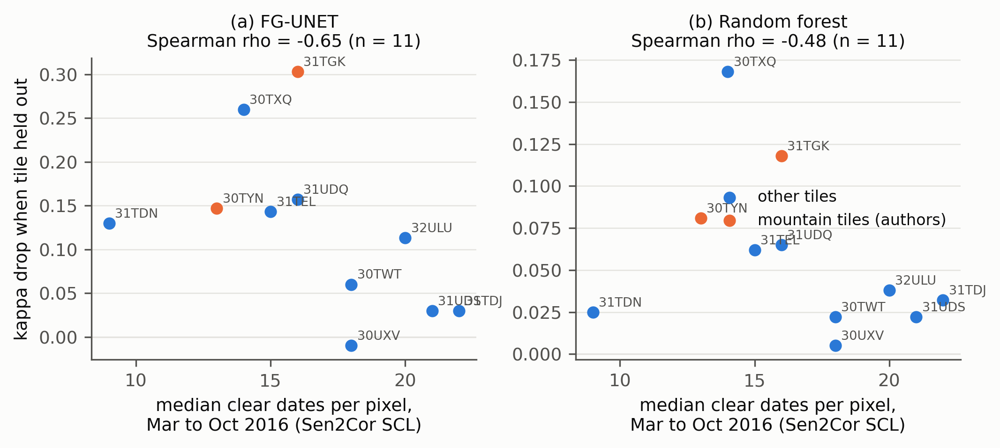

# Stoian et al. 2019 audit: do the largest leave-one-tile-out kappa drops follow sparse clear observations?

Stoian et al. 2019 ([Remote Sensing 11:1986](https://doi.org/10.3390/rs11171986); HAL deposit [hal-02627773](https://hal.science/hal-02627773); code [Zenodo 1474224](https://zenodo.org/record/1474224), source only) train a random forest (RF) and a fully convolutional U-Net variant (FG-UNET) on eleven French Sentinel-2 tiles in 2016 and, in Section 5.3 and Figure 19, compare each tile's kappa when it is part of training (11 tiles) with its kappa when it is held out (10 tiles + 1 test). They attribute the large drops on the mountain tiles T30TYN and T31TGK to "tile content". They also state that clear acquisitions range from about five in "northern and mountainous areas" to more than 30 in the Mediterranean, and that iota2 linearly gap-fills every pixel to 33 dates, but they give no per-tile clear counts. This audit measures per-tile clear counts independently and asks whether they co-vary with the drops. Nothing is re-run. The desk check behind it is `research_notes/Missingness confound audit of transfer papers/stoian_desk_check.md`; the scratch scripts that produced its numbers were lost, and everything cited from this audit comes from the scripts here.

## What was measured

1. Per-pixel 2016 clear counts per tile from Microsoft Planetary Computer `sentinel-2-l2a` (Sen2Cor L2A, 2021 reprocessing). The scene classification layer (SCL) of every 2016 granule of the tile (63 to 97 dates) was read at 1/16 overview resolution, a 344 x 344 grid of about 320 m, with nearest-neighbour resampling. Granules of the same date are merged (a pixel takes a clear value if any granule has one). Clear is SCL in {2, 4, 5, 6, 7, 11}, so snow is valid. Statistics are over land pixels (at least one clear observation and water in under half of them): median and 10th percentile of the yearly count, median of the March to October count, and the median over pixels of the longest March 1 to October 31 interval without a clear date (`common.tables.longest_gap_days` definition, vectorised and tested against it). For T30TYN a second count is made over the part inside France (geoBoundaries gbOpen FRA ADM0, pinned commit).
2. L1C granule effective clear count from the Copernicus Data Space OData catalogue: the sum over 2016 granules of (1 - cloudCover/100) times the share of the nominal tile square covered by the granule footprint, for the year and for March to October.
3. Figure 19 kappas, digitised from the raster embedded in the HAL PDF (739 x 312 px). The y axis is calibrated from the eight tick labels (1 px = 0.0033 kappa; fit residual below 1e-15). Each of the four marker series is found by colour (anti-aliased edges are blends with white). A marker partly covered by another is placed by sliding a template cut from the fully visible markers of that series, penalising template pixels that fall on neither the series' own colour nor another marker. A marker is flagged partly hidden if its box overlaps another series' marker and its visible share of the template is under 90 percent of the series' unobstructed median.
4. Table 1 class areas per tile (paper p. 6 of 26, PDF page 7), transcribed by parsing the page text. All 17 printed row totals reconcile. The printed column totals exceed the sum of the 17 rows by 5 to 9 ha per tile (74 ha overall); this is in the paper and is logged in `run_log_02_transcribe_table1.json`, not corrected. The Jensen-Shannon composition index of a tile is the base-2 divergence between its class distribution (water excluded) and the pooled distribution of the other ten tiles.
5. Spearman and Pearson correlations of each clear-count measure with the kappa drops and held-out kappas, the nine-tile variant without T30TYN and T31TGK, the leave-one-out range, rank partial correlations against the composition index, and a two-variable OLS R squared.

## How to run

```bash
conda activate ee
python experiments/external_audits/stoian/01_digitise_fig19.py        # downloads the HAL PDF (SHA-256 manifest), results/fig19_kappa_digitised*.csv
python experiments/external_audits/stoian/02_transcribe_table1.py     # results/table1_class_areas.csv
python experiments/external_audits/stoian/03_scl_clear_counts.py      # Planetary Computer SCL, about 5 min; results/scl_*.csv (--refetch to re-read tiles)
python experiments/external_audits/stoian/04_l1c_effective_clear.py   # CDSE OData, results/l1c_*.csv
python experiments/external_audits/stoian/05_summarise.py             # results/stoian_*.csv, figures/stoian_clear_vs_kappa_drop.png
```

or `bash experiments/external_audits/stoian/run.sh`. Each step skips work whose output exists and takes `--force`. Step 03 caches one SCL stack per tile (11 files, under 20 MB) under `/mnt/bigdrive/external_audits/stoian/`; `99_cleanup.py` deletes them and the PDF once results are complete and keeps `manifest.json`. Planetary Computer is queried with plain `requests` (STAC search plus the anonymous SAS token endpoint), so no `planetary-computer` or `pystac-client` package is needed. Extra dependency beyond the `ee` environment pins: PyMuPDF 1.28.2 (`import fitz`, already installed there) and Pillow 12.2.0. Fixed seed 42 (no step is stochastic). Tests: `python -m pytest experiments/external_audits/tests -q -k stoian`.

## Results

Per tile (SCL = Planetary Computer Sen2Cor, land pixels; kappas digitised; drop = 11-tile kappa minus 10+1 kappa; `results/stoian_tile_table.csv`):

| Tile | SCL median clear, year (Mar to Oct) | SCL p10, year | Gap Mar to Oct (d) | L1C eff. clear, year (Mar to Oct) | FG-UNET 11 | FG-UNET 10+1 | FG drop | RF 11 | RF 10+1 | RF drop | Composition JSD |
|---|---|---|---|---|---|---|---|---|---|---|---|
| T30TWT | 22 (18) | 9 | 47 | 17.5 (13.5) | 0.847 | 0.787 | 0.060 | 0.822 | 0.800 | 0.022 | 0.21 |
| T30TXQ | 17 (14) | 14 | 50 | 19.2 (14.8) | 0.913 | 0.653 | 0.260 | 0.855 | 0.687 | 0.168 | 0.35 |
| T30TYN (mountain) | 18 (13); French part 15 (10) | 9 | 47 | 27.1 (17.9) | 0.610 | 0.463 | 0.147 | 0.668 | 0.587 | 0.081 | 0.23 |
| T30UXV | 24 (18) | 12 | 40 | 23.9 (17.6) | 0.927 | 0.937 | -0.010 | 0.922 | 0.917 | 0.005 | 0.33 |
| T31TDJ | 28 (22) | 18 | 30 | 26.2 (20.1) | 0.800 | 0.770 | 0.030 | 0.762 | 0.730 | 0.032 | 0.10 |
| T31TDN | 13 (9) | 10 | 50 | 16.7 (11.5) | 0.913 | 0.783 | 0.130 | 0.882 | 0.857 | 0.025 | 0.28 |
| T31TEL | 18 (15) | 13 | 40 | 20.5 (15.2) | 0.850 | 0.707 | 0.143 | 0.792 | 0.730 | 0.062 | 0.12 |
| T31TGK (mountain) | 23 (16) | 16 | 33 | 28.1 (18.8) | 0.690 | 0.387 | 0.303 | 0.675 | 0.557 | 0.118 | 0.35 |
| T31UDQ | 21 (16) | 10 | 50 | 20.8 (14.1) | 0.840 | 0.683 | 0.157 | 0.715 | 0.650 | 0.065 | 0.40 |
| T31UDS | 26 (21) | 22 | 50 | 27.2 (20.7) | 0.920 | 0.890 | 0.030 | 0.862 | 0.840 | 0.022 | 0.31 |
| T32ULU | 26 (20) | 16 | 33 | 23.8 (16.9) | 0.900 | 0.787 | 0.113 | 0.858 | 0.820 | 0.038 | 0.13 |

Figure 19 markers: 44 digitised, 19 flagged partly hidden (`partly_hidden` in `results/fig19_kappa_digitised.csv`; the RF 10+1 series is never hidden). Fully visible markers are good to about 0.005 kappa, hidden ones to about 0.015, and all four markers at T30UXV overlap. Tile-level dates: 63 to 97 per tile (`results/scl_dates.csv`).

Correlations, n = 11 (Spearman rho with p, Pearson r; `results/stoian_correlations.csv` has all 28 pairs and the held-out-kappa targets):

| Clear-date measure | vs FG drop | vs RF drop |
|---|---|---|
| SCL median, year | -0.59 (0.05), -0.46 | -0.40 (0.23), -0.36 |
| SCL median, year, T30TYN French part | -0.58 (0.06), -0.44 | -0.39 (0.24), -0.36 |
| SCL median, Mar to Oct | -0.65 (0.03), -0.51 | -0.48 (0.14), -0.35 |
| SCL 10th percentile, year | -0.18 (0.59), -0.12 | +0.05 (0.88), -0.02 |
| Longest Mar to Oct gap (sign flipped) | -0.20 (0.55), -0.04 | -0.03 (0.92), -0.10 |
| L1C effective clear, year | -0.04 (0.92), -0.04 | +0.15 (0.65), +0.03 |
| L1C effective clear, Mar to Oct | -0.25 (0.46), -0.22 | +0.03 (0.94), -0.05 |

Without T30TYN and T31TGK (n = 9), SCL median, year, gives rho -0.73 (p 0.03) against the FG drop and -0.36 against the RF drop; March to October gives -0.72 and -0.38. Leave-one-out on the 11-tile Spearman (SCL March to October against FG drop) stays between -0.72 and -0.57. The composition index correlates with the FG drop at rho +0.46 and the RF drop at +0.32, and with the clear count at -0.31. Partial Spearman, SCL March to October against FG drop given composition: -0.60 (RF -0.42); composition given SCL March to October: +0.36 (RF +0.20). OLS R squared of FG drop on both: 0.30 (RF 0.18). The share of bare rock, natural grassland and glacier (BRO + NGL + GPS) correlates with held-out kappa at Pearson r -0.85 (FG-UNET) and -0.75 (RF); T30TYN and T31TGK hold 98 percent of bare rock, all glacier and 86 percent of natural grassland in the table. All values in `results/stoian_extras.csv`.



### Differences from the desk check

Most numbers reproduce the desk check (SCL medians, Mar to Oct medians, L1C values within about 0.6, kappas within 0.007, correlations within 0.02, leave-one-out range, partial correlations, R squared, mountain-share correlations). Differences: (a) the French part of T30TYN has a median of 15 clear dates (10 in March to October), not 23 as in the note; the note's value is higher than the whole-tile median of 18, which cannot be right for the cloudier French side, and I could not recover how it was obtained, so the note's figure should be dropped and the note's conclusion that the French half is "no sparser than the tile" reversed (it is sparser, second sparsest after T31TDN if ranked among the other tiles' whole-tile values, but the correlation is unchanged at rho -0.58). (b) The median longest gap is 33 days for T31TGK (note: 30) and 47 for T30TYN (note: 48.5); the gap measure is uncorrelated with the drops either way. (c) The composition index correlations are +0.46 (FG) and +0.32 (RF) against the note's +0.49 and +0.32; the exact class set and normalisation used then are unknown. (d) L1C correlations are near zero here as in the note, with small sign differences (L1C year vs RF drop +0.15, note +0.21).

## Finding

The mountain-specific missingness story does not hold, and a weaker general one is visible but not established. Measured independently, the two mountain tiles are not at the sparse end of 2016: T31TGK has a median of 23 clear dates (seventh sparsest of eleven, 16 from March to October) and one of the shortest March to October gaps (33 days, against 30 to 50), T30TYN 18 (tied third sparsest, 13 from March to October), and on L1C granule cloud cover they are the two clearest tiles. The sparsest tile, T31TDN (13 dates, 50-day gaps), loses only 0.130 FG-UNET kappa and 0.025 RF kappa. Across all eleven tiles, though, the per-pixel clear count correlates negatively with the FG-UNET drop (rho -0.59 for the year, -0.65 for March to October) and more weakly with the RF drop (-0.40, -0.48); the association is stronger without the mountain tiles (rho -0.72 to -0.73, n = 9), survives leaving out any one tile (-0.57 to -0.72) and a partial control for class-composition divergence (-0.60), and is carried by lowland tiles, mainly T30TXQ (sparse, large drop) against T31TDJ, T31UDS and T30UXV (dense, small drop). The largest drops on the mountain tiles coincide instead with class novelty: those two tiles hold almost all of the bare rock, glacier and natural grassland, which are nearly absent from the training pool when either is held out. The audit therefore withdraws the card's wording that the largest drops fall at the sparse end of the authors' range, and replaces it with a restatement: acquisition density was not reported, and it co-varies with the FG-UNET transfer drop across lowland tiles, at about the strength of a class-composition index, in an n = 11 rank statistic.

## Limitations of this audit

Sen2Cor SCL from the 2021 reprocessing and the L1C granule cloud percentage are proxies for the Theia MAJA masks that iota2 used in 2016, and the two proxies disagree (the L1C measure shows no relation with the drops and ranks the mountain tiles as clearest), so the sign of the clear-count association depends on the proxy chosen. Counts are over all land pixels read at about 320 m, not over the labelled pixels at 10 m, and the reference polygons were not available. Whether iota2 gap-fills snow is assumed (snow counted as clear) and was not checked against the 2016 iota2 version. The kappas come from a figure raster, with partly hidden markers good to about 0.015, the results are a single run per model with no error bars, and Spearman correlations on eleven tiles carry roughly 0.3 of sampling noise on rho with about 28 pairs looked at and no multiplicity correction. The French part of T30TYN uses a simplified national boundary. Nothing here re-runs the paper's models, so the audit cannot say how much of any drop is due to missingness.
