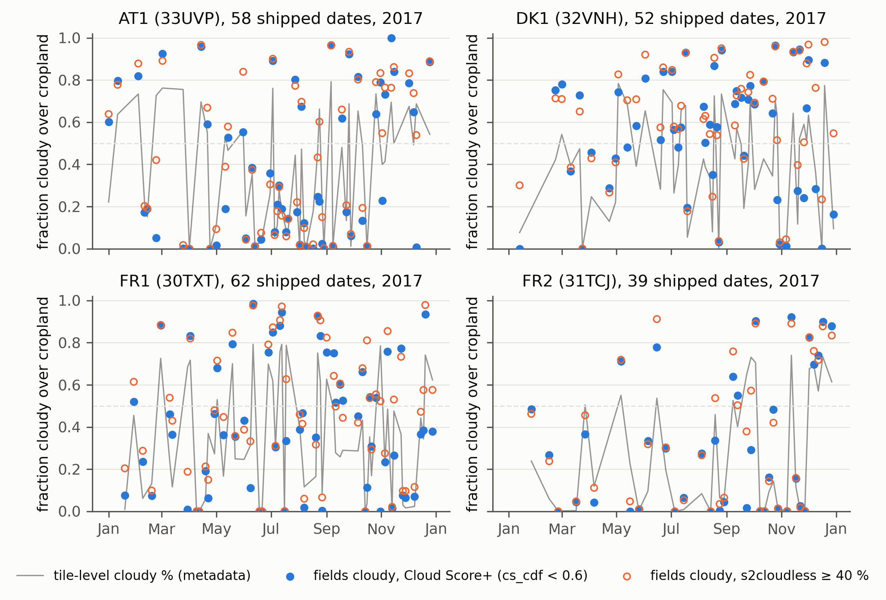

# TimeMatch audit: how cloudy were the four tiles' shipped observations?

Nyborg et al. 2022 (ISPRS JPRS 188, [10.1016/j.isprsjprs.2022.04.018](https://doi.org/10.1016/j.isprsjprs.2022.04.018); data [Zenodo 5636422](https://zenodo.org/records/5636422); code [jnyborg/timematch](https://github.com/jnyborg/timematch)) report a 43 point macro-F1 collapse when a model trained on one Sentinel-2 tile is applied to another (mean 82.0 target-trained versus 39.2 source-only across five tile pairs) and attribute it to a 30 to 35 day shift in crop calendars. The dataset keeps every L1C acquisition whose tile-level cloudy-pixel percentage is at most 80 and applies no per-pixel cloud mask, so cloudy pixels enter the model as observations. The paper reports no per-tile cloud statistic. This audit measures one.

## What was measured

For each of the 211 acquisition dates shipped in `metadata.pkl` (AT1 33UVP 58, DK1 32VNH 52, FR1 30TXT 62, FR2 31TCJ 39, all 2017) the Sentinel-2 granules of that MGRS tile and date were located in Earth Engine (`COPERNICUS/S2_HARMONIZED`, matched on `MGRS_TILE`) and the fraction of cropland pixels flagged cloudy was computed over the tile footprint intersected with ESA WorldCover 2020 cropland (class 40), at 60 m sampling, under three rules: Cloud Score+ `cs_cdf < 0.6` (primary), s2cloudless probability at least 40 percent (the shared cross-paper rule), and s2cloudless at least 16 percent (what DENETHOR's literal `cld < 40` on a 0 to 255 scale amounts to). Summing the per-date fractions gives the expected number of cloudy (or clear) observations in a parcel's series on that tile.

The TimeMatch arrays lack bands B01, B09 and B10, so s2cloudless could not be run on the stored pixels themselves; the Earth Engine products are computed from the same L1C granules.

## How to run

```bash
conda activate ee
python experiments/external_audits/timematch/01_fetch_footprints.py   # range-fetches 43 shapefile members from the Zenodo zip, writes results/timematch_dates.csv
python experiments/external_audits/timematch/02_ee_cloud_by_date.py   # 211 Earth Engine reductions, resumable; writes results/cloud_by_date.csv
python experiments/external_audits/timematch/03_summarise.py          # results/tile_summary.csv, results/monthly_summary.csv, figures/timematch_cloud_by_date.png
```

Every run writes `results/run_log_<script>.json` with counts, collection ids, thresholds and the Earth Engine image ids used.

## Results

Per tile, 2017 (Cloud Score+ unless stated; "obs" = observations in one parcel's series):

| Tile | Shipped dates | Mean tile-level cloudy % (metadata) | Mean fraction of fields cloudy | Dates with over half of fields cloudy | Expected cloudy obs per series | Expected clear obs per series | Expected clear obs, s2cloudless 40 % |
|---|---|---|---|---|---|---|---|
| AT1 33UVP | 58 | 36.4 | 0.374 | 23 | 21.7 | 36.3 | 33.4 |
| DK1 32VNH | 52 | 40.9 | 0.550 | 32 | 28.6 | 23.4 | 20.3 |
| FR1 30TXT | 62 | 34.6 | 0.404 | 23 | 25.0 | 37.0 | 33.2 |
| FR2 31TCJ | 39 | 27.3 | 0.314 | 11 | 12.3 | 26.7 | 25.6 |

Expected clear observations per series inside the growing season, April to September (monthly values rounded; the last column is the unrounded sum from `results/monthly_summary.csv`):

| Tile | Apr | May | Jun | Jul | Aug | Sep | Apr to Sep |
|---|---|---|---|---|---|---|---|
| AT1 | 2.5 | 2.7 | 4.2 | 6.1 | 7.7 | 3.3 | 26.4 |
| DK1 | 1.8 | 1.2 | 0.8 | 2.4 | 3.5 | 1.9 | 11.7 |
| FR1 | 4.5 | 1.8 | 3.7 | 2.7 | 4.0 | 1.9 | 18.5 |
| FR2 | 1.0 | 2.3 | 1.6 | 1.9 | 4.3 | 2.5 | 13.6 |



## Finding

The Danish tile is the cloudiest of the four by every rule. Over its 52 shipped dates a parcel series on DK1 is expected to contain 28.6 cloud-contaminated observations and only 23.4 clear ones, against 25.0 cloudy and 37.0 clear on FR1 and 12.3 cloudy and 26.7 clear on FR2. More than half of all cropland is cloudy on 32 of DK1's 52 dates, compared with 23 of 62 on FR1 and 11 of 39 on FR2. Inside the growing season the gap widens: between April and September a DK1 series holds about 11.7 clear observations against 18.5 on FR1 (1.6 times as many), 13.6 on FR2 (1.2 times) and 26.4 on AT1 (2.3 times), and in June, the month in which Danish winter cereals head, DK1 averages fewer than one clear observation. The tile-level metadata percentage that the dataset's 80 percent filter saw understates all of this, because it is computed over the whole granule rather than over fields and because a 40 percent cloudy tile can leave most of its cropland under cloud.

The paper's three Denmark transfer cases (DK1 to FR1, DK1 to FR2, FR1 to DK1) therefore pair the cloudiest tile with clearer ones, and in every case a source-only model meets a different mixture of cloud spectra from the one it was trained on. The paper never measures that difference. This audit cannot say how much of the 43 point collapse it explains; it does show that the Denmark pairs differ in growing-season clear observations by a factor of 1.6 (FR1) and 1.2 (FR2), in cloudy observations per series by 28.6 against 25.0 and 12.3, that the dataset's own filter cannot see the difference, and that TimeMatch's conclusion rests on an untested assumption that it does not matter.

## Limitations of this audit

Cropland support is WorldCover 2020 inside the tile footprint for all four tiles, not the 2017 LPIS parcels the model saw (Denmark ships no parcel polygons and the French and Austrian parcel files are too large for an Earth Engine request); the support is therefore symmetric across tiles but includes non-LPIS cropland. Cloud flags are Earth Engine products computed from the same L1C granules, not flags on the stored pixel arrays, and the 60 m reduction scale samples the 10 m flags. Cloud Score+ treats snow as clear while s2cloudless does not, which is why the two rules diverge in January; the growing-season numbers are insensitive to that choice. Nothing here re-runs the TimeMatch model.
