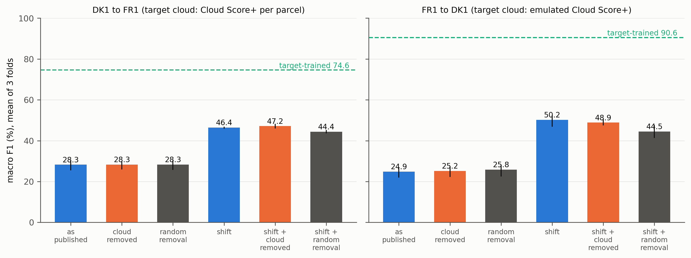

# TimeMatch re-run: does removing cloudy target dates explain the transfer gap?

The descriptive audit in `../timematch/` showed that the Danish tile (DK1, 32VNH) is the cloudiest of TimeMatch's four tiles and that the paper never tests whether cloud contamination matters. It left open the residual after shift correction, 24 macro-F1 points on average and 38.5 on FR1 to DK1. This folder answers that question with the authors' own released models: the frozen source-only LTAE classifiers of Nyborg et al. 2022 ([10.1016/j.isprsjprs.2022.04.018](https://doi.org/10.1016/j.isprsjprs.2022.04.018); code [jnyborg/timematch](https://github.com/jnyborg/timematch) at commit a652df9; data and models [Zenodo 5636422](https://zenodo.org/records/5636422)) are evaluated on target parcels with cloud-flagged dates removed, against a control that removes the same number of dates at random. Nothing is retrained. Progress notes, including the GPU crash and restart, are in `PROGRESS.md`.

## What was done

Two directions, DK1 to FR1 (FR1 = 30TXT) and FR1 to DK1, three folds each, using the authors' random parcel split (python `random`, seed 1), all target dates and all pixels, and the authors' `evaluation()` path. The LTAE has no padding mask and embeds day-of-year positions, so removing a date shortens the sequence; parcels are batched by (dates kept, pixels).

Six conditions per fold: (a) as published; (b) cloud-flagged dates removed; (e) the same number of dates per parcel removed at random, 10 draws; (c) the paper's estimated shift applied to the target positions (+32 days for DK1 to FR1, -35 for FR1 to DK1, signs as in the authors' code, `positions + shift`); (d) shift plus cloud removal; (e_shift) shift plus matched random removal. The cloud effect is b minus e unshifted and d minus e_shift shifted, so the cost of simply having fewer dates is held fixed. A shift sweep from -60 to +60 days is reported as a diagnostic; it uses target labels to pick the best shift, so it is not a deployable method.

Cloud flags. FR1 ships parcel polygons (115,755, EPSG:32630), so every FR1 test parcel gets an exact per-parcel, per-date Cloud Score+ fraction from the `S2_HARMONIZED` granules of 30TXT on the shipped date; a date is cloudy when more than half the parcel has `cs_cdf` below the threshold (0.6 primary, 0.5 and 0.7 sensitivity). Denmark ships no parcel polygons, only 10 by 10 block polygons, so DK1 targets use (i) block-level Cloud Score+ over WorldCover cropland and (ii) an emulator: a classifier of the per-parcel Cloud Score+ flag from the stored band medians and means, trained on FR1 parcels. On held-out FR1 parcel-dates it reaches AUC 0.993 and accuracy 0.955 at threshold 0.6, and its DK1 block means correlate with Earth Engine block fractions at r = 0.83 (`results/emulator_validation.csv`). Both tiles also carry zero-filled parcel-dates with no Sentinel-2 coverage (11.2 percent on FR1, 7.2 percent on DK1); "+nodata" variants remove those as well.

## How to run

```bash
bash experiments/external_audits/timematch_rerun/run.sh   # env ee for Earth Engine and summaries, deep_field (GPU) for the model
```

Inputs (74 GB data zip, 113 MB models zip, authors' clone with `results/compat_fixes.patch` applied) live under `/mnt/bigdrive/external_audits/timematch_rerun/`; `run.sh` lists the manual steps. Every step resumes from its outputs. Run only one `06_run_conditions.py` process at a time: six concurrent GPU processes on the 12 GB RTX 3080 Ti ran out of memory and the machine froze. This folder is not part of `../run_all.sh` because it needs the GPU and the full archive.

## Results

Step 1 gate: the authors' loaders and `evaluation()` with the released models reproduce the archive's stored per-fold metrics exactly (largest difference 0.0) and the paper's Table 1, DK1 to FR1 macro F1 28.26 ± 1.94 (paper 28.3 ± 1.9) and FR1 to DK1 24.86 ± 1.99 (paper 24.9 ± 2.0) (`results/reproduction_summary.csv`).

Macro F1 (percent), mean of three folds, primary cloud source at threshold 0.6 (`results/conditions_summary.csv`, `results/cloud_effect_summary.csv`):

| Condition | DK1 to FR1 (per-parcel Cloud Score+) | FR1 to DK1 (emulated Cloud Score+) |
|---|---|---|
| (a) as published | 28.3 | 24.9 |
| (b) cloud-flagged dates removed | 28.3 | 25.2 |
| (e) same number removed at random | 28.3 | 25.8 |
| (c) shift (+32 / -35 days) | 46.4 | 50.2 |
| (d) shift + cloud removed | 47.2 | 48.9 |
| (e_shift) shift + random removal | 44.4 | 44.5 |
| TimeMatch (archive) | 57.4 | 52.1 |
| Target-trained (archive) | 74.6 | 90.6 |
| Dates kept per parcel, cloud removal | 39.8 of 62 | 23.0 of 52 |

Cloud effect against matched random removal, shifted (d minus e_shift), in macro-F1 points: DK1 to FR1 +2.3 to +2.7 across thresholds 0.5 to 0.7 and +4.6 with no-coverage dates also removed; FR1 to DK1 +4.0 to +5.9 with the emulator, +3.0 with block-level flags, +7.1 with no-coverage dates also removed. As a share of the gap between the shifted model and the target-trained bound that is 8 to 15 percent, and 17 to 18 percent with the no-coverage dates. Unshifted (b minus e) the effect is between -0.9 and +1.0 points in every variant.

The label-selected best shift reaches 47.2 (+40 days) for DK1 to FR1 and 52.5 (-32 days) for FR1 to DK1, the latter level with TimeMatch's 52.1.



## Finding

Cloud contamination explains little of TimeMatch's transfer gap; the calendar shift explains most of it. Without the shift, deleting every cloud-flagged date from the target series leaves macro F1 where it was (28.3 to 28.3 for DK1 to FR1, 24.9 to 25.2 for FR1 to DK1), indistinguishable from deleting the same number of dates at random, even though it removes about a third of the French dates and more than half of the Danish ones. Shifting the target positions by the paper's own estimate adds 18 and 25 points with cloud content unchanged. Once the shift is applied, cloudy dates do carry less information than clear ones: dropping them costs 2 to 7 points less than dropping the same number at random. But dropping them does not beat keeping them (+0.8 and -1.3 points over shift alone), so cloudy target observations dilute the signal without misleading the model, and removing them closes only 8 to 18 percent of the remaining gap to a target-trained model. This is the residual the descriptive audit left open, and it is mostly not cloud. TimeMatch stays a paper whose tiles differ in cloud structure in a way it never reports, but its central attribution of the source-only collapse to a temporal shift survives a direct test with its own models.

## Limitations of this audit

Only test-time removal is tested. The source models were trained on cloudy source series, so the experiment does not show what a model trained on cloud-masked source data would do, and a training-time remedy (masking or observation dropout during training) could close more of the gap than test-time deletion. Danish cloud flags are emulated from FR1 parcels or taken at block level, because DK1 parcel polygons are not shipped; the emulator validates well on FR1 and agrees with DK1 blocks at r = 0.83, but it is not a per-parcel measurement on DK1. Cloud Score+ is computed on the same L1C granules but at 10 m over the polygon, not from flags on the stored pixel arrays. Only two of the paper's five transfer pairs are re-run (those with DK1 and FR1, where parcel-level FR1 flags exist), and only for the source-only model, not TimeMatch itself. Two compatibility fixes were needed to run the 2022 code on current libraries (`np.long` to `np.int64`; `torch.load(..., weights_only=False)`), neither of which changes the numbers, as the exact reproduction shows.
