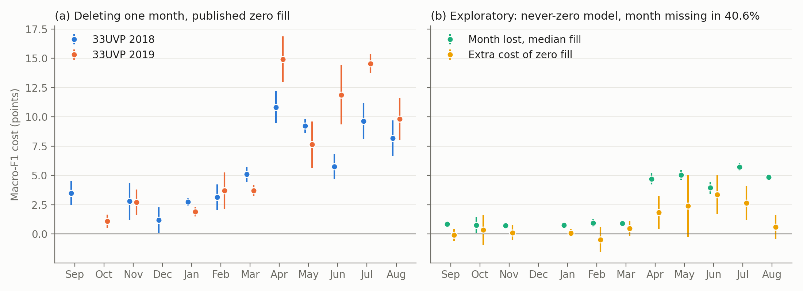

# TimeSen2Crop re-run: does hard zero fill break transfer when gentler fills do not?

Causal re-runs of TimeMatch, DENETHOR and Sen4AgriNet found missingness real but cheap, and all three involve gentle gap handling. Our own AI4FoodSecurity case, where zero-filling a month costs dense pixel networks 9 to 15 macro-F1 points, involves hard zero fill. This folder tests whether zero fill is the difference, on the one public benchmark whose official recipe zero-fills whole months and whose labels cover a second year on the same tile (Weikmann, Paris and Bruzzone 2021, [10.1109/JSTARS.2021.3073965](https://doi.org/10.1109/JSTARS.2021.3073965); data [Zenodo 4715631](https://zenodo.org/records/4715631), no code or models released). The paper reports no cross-year score, so this audits a hypothesis, not a claim of the paper, and the paper stays rank 2 either way. The hypothesis was formed after seeing the earlier results, so the pass marks were written down before any training (`docs/superpowers/specs/2026-11-05-timesen2crop-rerun-design.md`).

## What was done

Monthly clear medians September to August by the paper's rule. 13 tiles train, 33TWN validates and 33UVP 2017-18 tests, as in the paper, and the labelled 2019_33UVP tile gives the year transfer. LSTM and TempCNN hyperparameters come from a random search over the paper's ranges (10 configurations each, zero fill, chosen on 33TWN), then stay fixed: 30 epochs, best checkpoint on 33TWN, 5 seeds per trained condition.

Conditions, training fill to test fill: Z to Z (published zero fill); Z to M and Z to L (frozen zero-trained model, test gaps filled with training-pool monthly medians or linear interpolation); M to M and L to L (retrained on that fill); Zm to Zm (zero fill plus a present-month channel); M to Z (positive control: a model that never saw a zero, tested with zeros). At test time only, each month is deleted in turn, and each year's empty-month pattern is imposed on the other against a matched random deletion.

## How to run

```bash
bash experiments/external_audits/timesen2crop_rerun/run.sh   # env deep_field (GPU), about 1 hour
```

The zip (1.08 GB) and derived arrays live under `/mnt/bigdrive/external_audits/timesen2crop_rerun/`. Not part of `../run_all.sh`.

## Results

Empty months, the statistic the paper never reports (`results/empty_month_share.csv`). Share of pixels with no clear acquisition:

| | Sep | Oct | Nov | Dec | Jan | Feb | Mar | Apr | May | Jun | Jul | Aug | Mean months |
|---|---|---|---|---|---|---|---|---|---|---|---|---|---|
| 13 training tiles | 21 | 14 | 27 | 43 | 60 | 80 | 21 | 8 | 9 | 3 | 2 | 1 | 2.9 |
| 33UVP 2018 | 0 | 100 | 38 | 77 | 3 | 34 | 14 | 0 | 0 | 5 | 0 | 0 | 2.7 |
| 33UVP 2019 | 100 | 0 | 10 | 100 | 70 | 27 | 41 | 0 | 18 | 0 | 0 | 0 | 3.7 |

Reproduction gate (`results/reproduction.csv`): LSTM 84.0 ± 0.6 percent OA on 33UVP 2018 against the paper's 83.44, which passes. TempCNN 87.2 ± 0.6 against 81.71 misses the 2-point gate, on the high side, so under the design it is reported but not interpreted. The paper says it did no extensive tuning, and a stronger TempCNN is the likely reason, but that was not tested.

Year loss, 33UVP 2018 minus 2019 under the published fill (`results/year_gap.csv`): LSTM 3.4 macro-F1 points (95 percent CI 2.3 to 4.5), 1.5 OA points, 3.1 OA points at the 2018 class prior. There is little loss to explain.

LSTM macro F1 (`results/condition_summary.csv`, `results/fill_lifts.csv`), lifts against Z to Z paired over seeds:

| Condition | 33TWN | 33UVP 2018 | 33UVP 2019 | Lift 2018 (CI) | Lift 2019 (CI) |
|---|---|---|---|---|---|
| Z to Z, published | 77.0 | 76.7 | 73.3 | | |
| Z to M, frozen | 73.4 | 74.1 | 71.2 | -2.7 (-3.4, -2.0) | -2.1 (-5.2, +1.0) |
| Z to L, frozen | 73.7 | 73.0 | 70.1 | -3.7 (-4.9, -2.5) | -3.2 (-4.9, -1.5) |
| M to M, retrained | 77.4 | 76.7 | 72.5 | 0.0 (-1.9, +2.0) | -0.7 (-1.5, 0.0) |
| L to L, retrained | 77.3 | 76.6 | 75.1 | -0.1 (-1.3, +1.1) | +1.8 (+0.9, +2.7) |
| Zm to Zm, mask channel | 79.6 | 79.5 | 76.1 | +2.8 (+1.6, +4.0) | +2.8 (+0.6, +5.0) |
| M to Z, positive control | 69.6 | 70.5 | 67.3 | | |

Verdict under the fixed pass marks (`results/verdict.csv`): **Weak**, not Supported. The best condition on 33TWN for the LSTM is the mask channel, +2.8 points on 2019 with an interval above zero, but it lifts 2018 by the same 2.8, so it is a better input everywhere and not a transfer effect. The positive control fails its mark: a model that never saw a zero falls 5.2 points on 2019 (CI 2.6 to 7.7) and 6.3 on 2018 when tested with zeros, against the 10 required (`results/assay_check.csv`). TempCNN, for the record: best condition L to L, +1.9 (CI -0.5 to +4.2) on 2019, control fall 0.9.

Where the gaps fall (`results/month_deletion.csv`, LSTM, published fill). Deleting a month costs 5.8 to 14.9 macro-F1 points from April to August and 1.1 to 5.1 from September to March. The months 2019 actually lacks are nearly all in the cheap group. Imposed patterns (`results/pattern_imposition.csv`): 2019 gaps on 2018 pixels cost 12.5 points, while the same number of months deleted at random costs 20.8.

Exploratory, added after seeing the verdict and outside the pass marks (`results/exploratory_month_zero_vs_median.csv`). The closest analogue of our case: a never-zero model with one month missing in 40.6 percent of pixels, pooled over both years. For the LSTM, April to August cost 3.9 to 5.7 points with a median fill and a further 0.6 to 3.4 with zeros (mean 2.2). September to March cost about 1 with a median fill and about 0 further with zeros. TempCNN's extra cost in April to August runs 2.1 to 7.0.



## Finding

Hard zero fill is not what breaks transfer on this benchmark. Under the pass marks fixed in advance the result is Weak: the only lift that clears its interval for the LSTM's selected condition is equal on both years, so it says nothing about transfer. Zero fill also cannot be blamed for much here, because the year loss itself is only 3.4 macro-F1 points, even though the two years have sharply different gaps (September and December entirely empty in 2019, October in 2018).

Two things seem to explain the mild result, and both are readings after the fact. The first is where gaps fall: nearly all natural gaps sit in months the models barely use, and random deletion of the same number of months costs far more than the natural pattern. The second is that a model that has seen zeros in training copes with them: the training pool has zeros in every month, and the zero-trained LSTM scores 73.3 on 2019 where the never-zero model given zeros scores 67.3. The positive control and the exploratory contrast suggest that zero fill does add a cost when it hits a month that matters and the model never saw it, about 2 points here on top of about 5 from losing the month. That is the same direction as our AI4FoodSecurity result and well below its 9 to 15, so this benchmark does not explain the size of that effect. Linear interpolation retrained (L to L) closes about half the LSTM's year gap (+1.8 on 2019, 0.0 on 2018), which is the most transfer-like signal here, but it was not the condition the rule selected and one of five comparisons should not carry weight alone.

## Limitations of this audit

The positive control missed its mark. The design said a null would then mean nothing, so this result cannot rule out a zero-fill effect in general; equally, the control is itself a direct measurement that zeros cost 5 points or less in the conditions tested. TempCNN missed its gate, leaving one interpreted model, and the design's verdict was calculated on it alone. Pixel samples carry no field or location identifiers, so pixels are treated as independent within tile, no in-domain bound can be built without leakage, and the year gap is the only transfer loss measured. Intervals cover seeds only (5 per condition), not sampling of tiles or years, and this is one tile and one year pair. Hyperparameters were chosen under zero fill and then fixed, which could favour zero fill slightly. Label sampling caps differ between the years (15,001 and 20,001 per class). The pooled months in the exploratory figure come from different tiles when a month is empty in one year. Weighted LSTM, the paper's best model, was not run.
