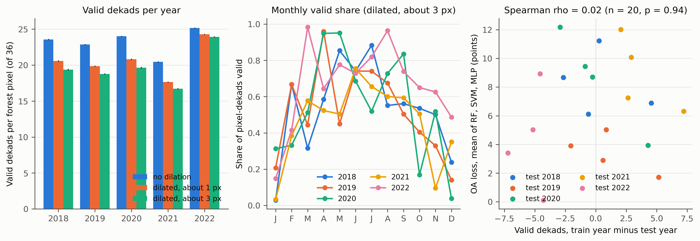

# Verhulst et al. 2024: how many dekads are valid in each year?

Verhulst, Van De Kerchove, Van Coillie and Van Meerbeek, Remote Sensing 16:2653 (2024), doi 10.3390/rs16142653.
Five tree species in Flanders from Sentinel-2 dekadal medians for 2018 to 2022; 20 cross-year scenarios with mean OA losses of 2.3 to 14.9
points per validation year. The authors call 2021 "a very wet year", note that its NDVI curves deviated most from January to June, and
say the differences are hard to attribute. They report no count of valid dekads. Plot data and code are not public.
This audit measures the gap structure their recipe leaves in each year and asks whether it lines up with the OA losses. No model is re-run.

## What the paper pins down (step 0)

Product: TERRASCOPE_S2_TOC_V2, the Belgian Sen2Cor Level-2A archive. Mask: SCL 4 and 5 kept, dilated with an 11 x 11 Gaussian kernel (sigma 1.5).
Then dekadal medians (days 1-10, 11-20, rest of month), linear interpolation between valid dekads, forward/backward fill at the series ends,
Savitzky-Golay smoothing (window 15). Every year is a 36-dekad series from January to December. That is enough to measure valid, interpolated
and edge-filled dekads. Not stated: the threshold applied to the dilated mask. Per-scenario OA is only in Figure 7 (boxplots), not a table.

## Method

1. `01_digitise_fig7.py` reads the two rasters of Figure 7 in the MDPI PDF: box medians (RF, MLP) and asterisks (SVM) for the 15 same-year and 20 cross-year
   cells per algorithm, and the bar losses of panels b-d. The mean of the four cross-year losses per validation year reproduces the bars within 0.5 points
   (mean 0.2) and the six values printed in the text within 0.5 (`results/fig7_digitising_check.csv`).
2. `02_forest_points.py` draws 40,000 seeded random points (seed 42) in the FAO GAUL "Vlaams Gewest" polygon and keeps 3,000 at ESA WorldCover v200
   tree cover (class 10).
3. `03_valid_dekads.py` uses `COPERNICUS/S2_SR_HARMONIZED` (Sen2Cor L2A, 791 to 809 scenes a year over Flanders, all months of 2018 covered). Per image, usable
   is SCL 4 or 5. Unusable pixels inside the footprint are blurred with `ee.Kernel.gaussian` (radius 5, sigma 1.5, normalised) and a pixel is dropped where the blurred share
   reaches a threshold. The paper gives none, so three variants are reported: `none` (no dilation), `d1` (0.05, reaches about 1 px from an unusable pixel) and `d3`
   (0.01, about 3 px; the primary variant). A dekad is valid at a pixel if any image has it usable. Sampling is at 10 m in UTM 31N.
4. `04_summarise_gaps.py` (`verhulstlib.gap_metrics`) counts valid dekads, interpolated dekads (empty, between first and last valid), edge-filled dekads, and the longest gap, per pixel.
5. `05_correlate_oa.py` correlates the 20 scenario losses (same-year OA minus cross-year OA, digitised) with the train-minus-test difference in valid dekads (Spearman).

## Results (primary variant d3, 3,000 forest pixels per year)

| Year | Valid dekads of 36 | Valid Jan-Jun (of 18) | Interpolated share | Edge-filled share | Mean longest gap Jan-Jun (dekads) | Mean longest interpolated run |
|---|---|---|---|---|---|---|
| 2018 | 19.4 | 9.6 | 0.30 | 0.16 | 4.0 | 3.9 |
| 2019 | 18.8 | 10.4 | 0.27 | 0.21 | 3.0 | 3.0 |
| 2020 | 19.7 | 11.2 | 0.27 | 0.18 | 4.1 | 3.6 |
| 2021 | 16.7 | 8.3 | 0.39 | 0.14 | 4.8 | 5.2 |
| 2022 | 23.9 | 11.1 | 0.19 | 0.15 | 3.9 | 2.0 |

Bootstrap SE of the valid-dekad means is under 0.11. Without dilation the counts are 23.6, 22.9, 24.0, 20.4 and 25.2; the ordering of years is the same.
About half of every year's 36 dekads are filled by interpolation or edge copying (33 to 54 percent). Per-dekad and monthly shares are in `results/dekad_valid_share.csv`;
January is nearly empty in 2018 and 2021 (3 percent of pixel-dekads valid), November 2021 is 10 percent.

Correlation of the 20 scenario losses with the train-minus-test valid-dekad difference (primary variant): RF rho 0.19 (p 0.42), SVM -0.23 (p 0.34), MLP 0.24 (p 0.32),
mean of the three 0.02 (p 0.94). Variants `none` and `d1` give the same (0.06 and 0.02). Test-year valid dekads alone give rho -0.14 (p 0.56), and
at validation-year level (n = 5, the bar losses) rho -0.36 (p 0.55). The longest Jan-Jun gap difference (test minus train) gives rho 0.46 (p 0.04) for the mean of the three,
0.57 for RF (p 0.008), 0.36 for SVM, 0.21 for MLP, but it is one of 8 predictors by 4 algorithms and weaker in the other variants (0.29, 0.39). By contrast the same-year OA of the test year
correlates 0.83 with the RF loss.

## Finding

2021 is the gappiest year over Flanders forest: 16.7 valid dekads of 36 against 18.8 to 19.7 in 2018 to 2020 and 23.9 in 2022, the fewest valid dekads in January to June (8.3 of 18),
the highest interpolated share (0.39) and the longest interpolated runs (5.2 dekads). So the year the authors flag as anomalous from January to June is also the one whose
series are most interpolated in that window, and the NDVI deviation they see there could partly be interpolation. That part of the hypothesis is supported. The second part is not:
OA losses do not track the train-minus-test difference in valid dekads (mean rho 0.02, n = 20, no sign consistency across RF, SVM and MLP). The largest loss in the paper, SVM validated on 2018 (14.9 points), is not a gappy
year, and 2022, the least gappy, has small mean losses for RF and MLP. Losses follow the test year's same-year baseline (RF rho 0.83) more than any measure of gaps.
Missingness therefore co-occurs with the anomalous year but does not explain the scenario-level losses; the verdict is inconclusive, closer to refuted for the quantitative claim, and the report's
note that the year with the fewest valid dekads is the wet year is confirmed.

## Limitations

The data are Earth Engine S2_SR_HARMONIZED, not the Terrascope product the authors used; both are Sen2Cor but scene selection, processing baseline and the SCL resampling to 10 m can differ. The dilation threshold is unknown and the
kernel is applied to SCL in the 10 m sampling grid, so absolute counts depend on the variant (2021: 16.7 with d3, 17.7 with d1, 20.4 without dilation) while the year ordering is stable. Points are WorldCover tree cover
(27 percent of Flanders, which includes hedgerows and urban trees), not the Flemish inventory plots, and sampling is on a point sample with spatial correlation, not a census. Valid dekads are a count of dekads with at least one usable
observation, not the paper's smoothed series. OA values are digitised from a raster to about 0.3 points (RF and MLP are box medians of 10 runs), and a collapsed MLP box (validation 2022, training 2019) is read from its median line. With n = 20 and only five
distinct year values per predictor, correlations are suggestive only; the 20 losses are not independent because each test year recurs four times and each train year four times.
