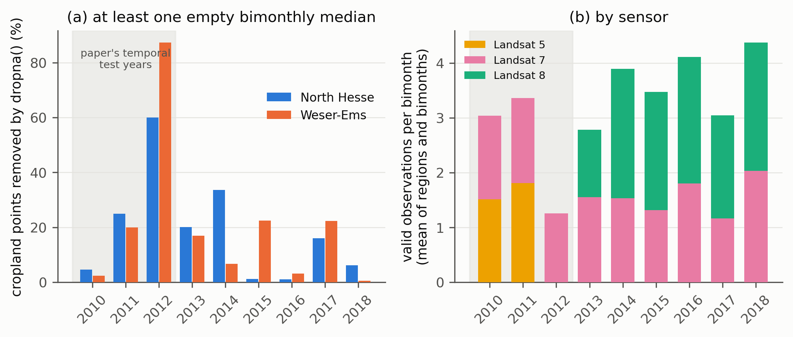

# Wijesingha, Dzene and Wachendorf 2024

ISPRS JPRS 213, doi 10.1016/j.isprsjprs.2024.05.020; code
https://github.com/jmatics/landsat-croptype-spatial-temporal-transferability.
The authors train on North Hesse (NH) and Weser-Ems (WE) for 2013 to 2018 and test on
2010 to 2012 (temporal), the other region (spatial) and both. Inputs are four bimonthly
median Landsat 5/7/8 composites (scenes under 60 percent cloud, `maskClouds()`, no fill),
and the notebooks apply `df.dropna()`, so a field with an empty composite is silently
removed. This audit measures how often that happens in each region and year. No model is re-run.

## Scripts

| Script | Output |
|---|---|
| `01_notebook_outputs.py` | `results/notebook_facts.csv`: what the saved notebook outputs and code show |
| `02_sample_cropland.py` | `results/cropland_points.csv`: 2000 random cropland pixels per region (seed 42) |
| `03_observation_counts.py` | `results/obs_counts_points.csv.gz`: valid observations per point, year, bimonth and sensor (Earth Engine, resumable) |
| `04_summarise.py` | `results/year_summary.csv`, `sensor_mix.csv`, `period_contrast.csv`, `figures/wijesingha_dropped_share.png` |

`wijesingha_lib.py` holds the pure functions (tests in `tests/test_wijesingha_lib.py`).
Run with `bash experiments/external_audits/wijesingha/run.sh` from the repo root in the `ee` env.

## Route

The notebooks' saved outputs print only post-`dropna()` array shapes (NH: 75,000 training sample,
432,876 validation, 21,916 holdout rows; WE: 75,000, 1,447,695, 22,034), never a pre-`dropna()` count,
so the dropped share cannot be read from them. Both notebooks exclude 2005, 2007, 2009 and 2010 to 2012
from training and hold out 2017 in one district (DE735 for NH, DE948 for WE); no fill, interpolation
or imputer appears in either. The second route was therefore used: the download recipe was ported to
Python Earth Engine. Per year 2010 to 2018, and per bimonth (Mar-Apr, May-Jun, Jul-Aug, Sep-Oct), a
scene observation counts as valid if its CLOUD_COVER is under 60, QA_PIXEL cloud and shadow bits are
clear (plus cirrus on Landsat 8, the eemont `maskClouds` rule), and all six SR bands are unmasked, so
SLC-off stripes count as no data. The median is empty where the count is zero; a point is dropped if any
of the four medians is empty (what `dropna()` does to a pixel row). The authors' median merges all
three sensors, as here.

## Results

Dropped share of cropland points (percent), with mean valid observations per bimonth in brackets:

| Year | NH | WE |
|---|---|---|
| 2010 | 4.6 (2.9) | 2.4 (3.2) |
| 2011 | 25.0 (3.6) | 20.0 (3.1) |
| 2012 | 60.0 (1.5) | 87.2 (1.0) |
| 2013 | 20.0 (3.0) | 16.9 (2.6) |
| 2014 | 33.6 (3.6) | 6.7 (4.2) |
| 2015 | 1.2 (3.9) | 22.5 (3.0) |
| 2016 | 1.0 (4.8) | 3.1 (3.4) |
| 2017 | 16.0 (2.9) | 22.4 (3.2) |
| 2018 | 6.2 (3.8) | 0.4 (4.9) |

Mean over the three test years: NH 29.8, WE 36.5 percent dropped; over the six training years: NH 13.0,
WE 12.0 percent. Valid observations per bimonth (mean of the four): test years NH 2.7, WE 2.4; training
years NH 3.7, WE 3.5. In 2012 there is no Landsat 5 and no Landsat 8, only striped Landsat 7 (about 1.0
to 1.5 valid observations per bimonth); in 2010 and 2011 Landsat 5 and 7 together give about 3 to 3.4.
Spatial scenario, same training years in the other region: dropped share 12.0 (WE) against 13.0 (NH).
The empty bimonth is mostly Mar-Apr for WE 2012 (78 percent of points) and Jul-Aug for NH 2011 and 2012 (25 and 48 percent).

## Finding

The confound is supported for 2012 and partly for 2011, and not for the test period as a whole. In 2012
(Landsat 5 gone, Landsat 8 not yet launched) `dropna()` would remove 60 percent of NH and 87 percent of
WE cropland points, far outside the 2013 to 2018 range (NH 1 to 34, WE 0.4 to 23 percent); 2011 removes
20 to 25 percent, about the top of the training range, and 2010 only 2 to 5 percent. Averaged over 2010
to 2012 the test years lose about 30 (NH) and 37 (WE) percent against 12 to 13 percent in training, so
the surviving test sample is a clearer, differently selected subset of fields, and the survivors in 2012
are those that happened to be seen by a striped sensor. The authors' spatial scenario carries no such
shift (12 against 13 percent), yet the NH random forest loses the same 0.120 mF1 there as under the temporal
and spatio-temporal scenarios, so a differential drop rate cannot explain that equal loss. Training
years are not clean either: 2013 (20 and 17 percent, Landsat 8 only from spring) and 2014 NH (34 percent) are gappy, and
year-to-year weather drives the rate as much as the sensor era. The drop rate is a plausible contributor to the
temporal loss, particularly through 2012, but this audit measures selection and cannot say how much of any mF1 loss it explains.

## Limitations

Points are random WorldCover (2021) cropland pixels, not the authors' IACS parcels, so crop mix, parcel
size and the effect of sampling a field mean rather than a pixel are not matched; the notebooks' pre-`dropna()`
row counts are unavailable, so the port is not validated against them. Region boundaries are geoBoundaries
Kassel and Weser-Ems, not their VG25 district shapefile, and the exact NH and WE extents they exported may differ.
`eemont` was not installed, so its `maskClouds` bit rule was read from the `ee_extra` source and re-implemented;
the SR band mask stands in for the SLC-off no-data and the `scale()` and index steps. The authors' 2013 to 2018 samples may
come from fewer years, and the paper's per-scenario mF1 values were behind a paywall; only the 0.120 NH figure from the audit
report card was used. Counts are for 2000 points per region (binomial error up to about 1 point).
